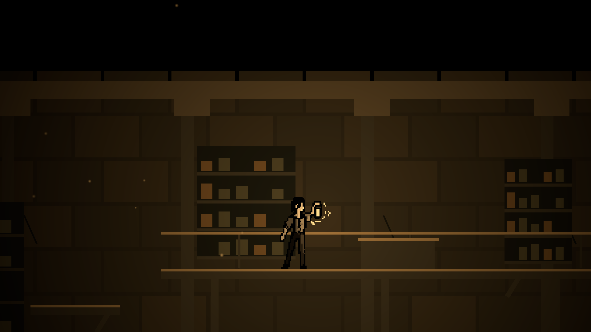
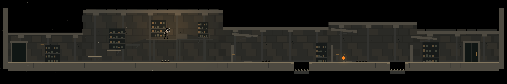

# The Ruined Archive

Authored in `MovementSandbox.unity`, Unity 6000.3.2f1. This layout replaces its small greybox while retaining the scene's player, light tuning, reactive embers, stamina HUD, lantern HUD, effects and ambient music. All work is scoped to Siraç's scene and this folder.

## Route

| Section | Position | Purpose |
| --- | --- | --- |
| Intake | x -10 to 1 | Safe walking/sprinting run-up; first ember at x -0.2. |
| Archive and upper office | x 1 to 21.5 | A safe introductory shelf jump, then a choice: continue below or climb three shelves to the office. The desk rewards the optional climb with ember 02. |
| Service crossing | x 21.5 to 37 | Checkpoint 01 at x 22.5; a short spike field, a generous landing/rest space, then a 2.2m broken bridge. |
| Collapsed gallery | x 37 to 50 | Checkpoint 02 at x 37.7; ember 03 at x 39.2; a four-spike field followed by a separate 2.2m gap. |
| Archive exit | x 50 to 62 | Safe decompression, filing-room silhouettes, an exit doorway at x 58 and a completion prompt. |

There are exactly **three collectible embers**. The office ember sits at `(15.5, 4.65)` on the desk. A lower passage bypasses that reward; its second shelf leaves clearance above the standing capsule. All hazards have a safe launch and landing. Worn ochre paint marks the danger edges; spikes have individual polygon triggers fitted inside the visible silhouettes. Pits use recessed spikes, with a separate void safety plane underneath the entire map.

## Movement and light

- Current scene tuning: walk 3.2m/s, sprint 5.5m/s, jump launch 9m/s, gravity scale 3.
- Ideal full-jump rise is approximately 1.38m; the office climbs in 0.8–0.9m steps. Same-height ideal sprint range is approximately 3.36m before capsule support/coyote time. The two gaps are 2.2m.
- Hold Space across gaps. Release Shift and rest on the wide landings to recover stamina.
- Flare reveals the masonry, stairs and spike silhouettes; no door requires fuel. The route cannot be blocked by an empty inventory.
- Checkpoints update the existing respawn controller. Backspace restores the start, checkpoint state and all three pickups. Existing fuel and stamina respawn rules apply.
- Route prompts appear at the top center, clear of the existing HUDs. World labels follow the actual interpolated light radius.

The warm, desaturated stone blocks, damaged arches, iron shelves, missing records and rubble are blockout scenery. They establish ruin silhouettes for playtesting and are not final environment artwork.

## Spike asset

`Art/SpikeSheet.png` is a transparent derivative of the user-supplied [reference](../../../../../../../art/shared/hazards/spike-reference.jpeg). The original JPEG contains a baked checkerboard. The built-in Imagegen tool removed that backdrop; five individual sprites are sliced through Unity's Sprite Editor data-provider API. The source artist is unconfirmed; this preparation does not assign authorship to a team member.

Extraction prompt: “Use case: background-extraction. Asset type: Unity 2D game hazard sprite strip. Edit target: attached image of exactly five pale grey conical floor spikes with dark hand-drawn outlines and dark oval bases, evenly spaced in a horizontal row. Remove ONLY the baked grey/white checkerboard background and replace it with actual alpha transparency. Preserve all five original spikes, their silhouettes, colors, black outlines, side-view perspective and spacing as closely as possible. Do not reinterpret, add spikes, text, scenery or effects. Tight horizontal composition with a little transparent padding around the row. Output genuinely transparent PNG.”

## Editing and validation

The scene hierarchy separates walkable geometry, scenery, spikes, ember reserves and route markers. Change those objects directly. `RuinedArchiveLevelBuilder.ApplyToCurrentScene()` is a one-time authoring helper and refuses to rebuild an existing level. Shared player prefabs, audio files and Kemal's sandbox are outside this layout pass. The accompanying stamina HUD redesign is documented in Siraç's workspace notes.

The local Play Mode integration suite exercises the real scene with keyboard input: continuous main-route completion, the optional office reward, spike contact, checkpoint recovery and full-route reset. All three tests passed in Unity 6000.3.2f1 via Unity MCP on 2026-10-16. Automated traversal checks feasibility; difficulty and final visual direction still need human playtesting.

## Previews

The service and office images use the actual Flare illumination. The overview uses temporary inspection lighting so the entire layout can be reviewed; that light is absent from the saved scene.

