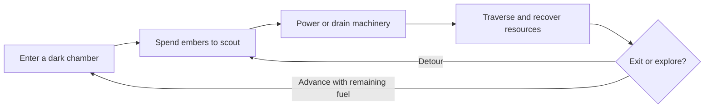

<div align="center">

# The Lighten Road

**Every flare reveals a path. Every second costs an ember.**

An atmospheric 2D puzzle-platformer about light, isolation, and the cost of survival.

**Pre-production** · **Unity 2D / C#** · **Pixel art**

[Game Design Document](docs/GDD.md) · [Latest GDD (PDF)](docs/The-Lighten-Road-GDD.pdf) · [Contributing](CONTRIBUTING.md)

</div>

---

## The game

Four hundred years after an apocalypse, Light, a condemned Ruin Researcher, enters a sealed pre-Fall facility to recover ancient technology in exchange for his freedom. An anomalous ember lantern is his only light. Deep inside the ruins, survival leads him toward an archive holding the truth behind the Fall.

The Lighten Road pairs deliberate platforming with environmental puzzles. Light reveals the route, but the fuel that makes exploration possible is also the resource keeping you alive.

## Core design

| System | The decision |
| --- | --- |
| **Dim / Flare** | Preserve ember fuel with a passive glow, or spend it for a wider view of paths, hazards, and hidden items. |
| **Power / Drain** | Spend lantern fuel to power machinery, or drain an active device to recover energy into the lantern while shutting it down. |
| **Connected chambers** | Fuel carries forward between rooms. The doorway seals behind you, making earlier choices matter. |
| **Exploration** | Take a direct route to safety or risk a detour for lore and additional embers. |



Movement consists of left/right movement and jumping, with no sprint, double-jump, or attack. Fuel depletion creates a **positive feedback loop (death spiral)**: less fuel limits visibility, making traversal harder and increasing survival pressure.

## Planned scope

The full design targets **4–5 puzzle chambers** across an **Abandoned Corporate Archive** and a **Subterranean Covert Lab**, with an estimated **15–20 minute** run. These are design targets, not measured playtest results.

The MVP focuses on **two Office stages** with movement and jumping, the lantern fuel economy, Ember Veins, rolling archive shelves, one lift, and electrified water. If time is limited, the laboratory zone will be cut so the Office stages can become a polished, self-contained experience.

## Current status

The shared Unity project uses **Unity 6000.3.2f1 / Universal 2D**. Siraç's sandbox now combines horizontal movement, one grounded jump, camera follow, an early lantern fuel / Dim-Flare prototype, and a reusable ember pickup. The movement Play Mode suite has four passing tests; the lantern and pickup have been compiled and inspected in Play Mode, but do not yet have automated coverage. Ember Veins, Office stages, and a standalone playable build remain planned.

- [x] Latest supplied GDD archived
- [x] Editable GDD and project overview
- [x] Create the Unity 2D project and record the editor version
- [ ] Review the proposed developer task split
- [ ] Agree on final input bindings, fuel tuning, and shared system interfaces
- [x] Prototype movement, single jump, and camera follow in Siraç's sandbox
- [x] Add a first lantern fuel API and Dim / Flare sandbox prototype
- [x] Add a reusable lantern fuel pickup to Siraç's sandbox
- [ ] Integrate Ember Veins with the shared lantern API
- [ ] Build and playtest the two Office stages
- [ ] Polish art, sound, puzzle readability, and recovery after failure
- [ ] Evaluate the laboratory zone after the MVP is stable

## Getting started

Clone the repository and open the Unity project:

```sh
git clone https://github.com/unitybtw/the-lighten-road.git
cd the-lighten-road
```

Open `Game/` in Unity Hub with editor **6000.3.2f1**, then open `Assets/_Project/Scenes/Sandbox/Sirac/MovementSandbox.unity` and press Play. Use **A/D or Left/Right** to move, **Space** to jump, and the current temporary **F** binding to toggle the lantern between Dim and Flare. The Game view shows the fuel meter. Start with [Game/README.md](Game/README.md) for setup and tests, and [docs/GDD.md](docs/GDD.md) for the design. Final input bindings, fuel balance, target platforms, and build instructions still need team review.

## Working as a team

Each teammate has a dedicated workspace for prototypes, art sources, or puzzle design. Start with the [collaboration guide](docs/COLLABORATION.md) for folder ownership, task branches, PRs, and Unity scene coordination. Review the [proposed developer task split](docs/DEVELOPMENT_PLAN.md) before implementation; assignments and interfaces there are a draft for the team to review.

## Repository guide

| Path | Contents |
| --- | --- |
| [docs/GDD.md](docs/GDD.md) | Editable design, MVP boundaries, and open decisions |
| [docs/COLLABORATION.md](docs/COLLABORATION.md) | Team workspaces and branch / review workflow |
| [docs/DEVELOPMENT_PLAN.md](docs/DEVELOPMENT_PLAN.md) | Draft ownership split for Siraç and Kemal to review |
| [development/](development/) | Separate Siraç and Kemal prototype workspaces |
| [art/](art/) | Separate Can and Maksim art sources and exports |
| [design/](design/) | Furkan’s level designs and balance proposals |
| [Game/](Game/) | Shared Unity 6000.3.2f1 Universal 2D project |
| [docs/The-Lighten-Road-GDD.pdf](docs/The-Lighten-Road-GDD.pdf) | Latest three-page team design document |
| [CONTRIBUTING.md](CONTRIBUTING.md) | Branch, review, and Unity asset workflow |

## Team

| Team member | Role | GitHub |
| --- | --- | --- |
| Siraç Göktuğ Şimşek | Game Developer | [@unitybtw](https://github.com/unitybtw) |
| Kemal Berke Aşık | Game Developer | [@kemal-berke](https://github.com/kemal-berke) |
| Can Mutluşahinoğlu | Artist | [@benesas](https://github.com/benesas) |
| Maksim Martynenko | Artist | [@Ichnolith](https://github.com/Ichnolith) |
| Furkan Aydın | Game Designer | [@aeshmacodex](https://github.com/aeshmacodex) |

Team credit describes authorship of the design; GitHub access and commit-based contributor listings are managed separately.

## Rights

No open-source license has been selected. Public visibility does not grant a general license to reuse the project's code, artwork, audio, or design materials. Third-party assets must retain their own license and attribution information.
