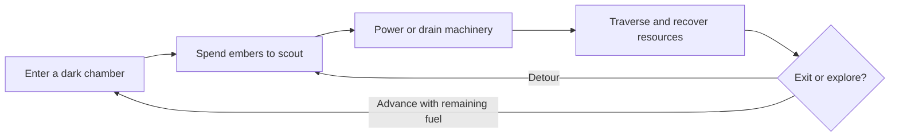

<div align="center">

# The Lighten Road

**Every flare reveals a path. Every second costs an ember.**

An atmospheric 2D puzzle-platformer about light, isolation, and the cost of survival.

**Pre-production** · **Unity 2D / C#** · **Pixel art**

[Game Design Document](docs/GDD.md) · [Original GDD (PDF)](docs/The-Lighten-Road-GDD.pdf) · [Contributing](CONTRIBUTING.md)

</div>

---

## The game

Four hundred years after an apocalypse, Light, a condemned Ruin Researcher, enters a sealed pre-Fall facility to recover ancient technology in exchange for his freedom. An anomalous ember lantern is his only light. Deep inside the ruins, survival leads him toward an archive holding the truth behind the Fall.

The Lighten Road pairs deliberate platforming with environmental puzzles. Light reveals the route, but the fuel that makes exploration possible is also the resource keeping you alive.

## Core design

| System | The decision |
| --- | --- |
| **Dim / Flare** | Preserve ember fuel with a passive glow, or spend it for a wider view of paths, hazards, and hidden items. |
| **Power / Drain** | Change the state of machinery through Ember Veins: move a platform, shift archive shelves, or stop a hazard. |
| **Connected chambers** | Fuel carries forward between rooms. The doorway seals behind you, making earlier choices matter. |
| **Exploration** | Take a direct route to safety or risk a detour for lore and additional embers. |



## Planned scope

The full design targets **4–5 puzzle chambers** across an **Abandoned Corporate Archive** and a **Subterranean Covert Lab**, with an estimated **15–20 minute** run. These are design targets, not measured playtest results.

The MVP focuses on **two Office stages** with movement and jumping, the lantern fuel economy, Ember Veins, rolling archive shelves, one lift, and electrified water. If time is limited, the laboratory zone will be cut so the Office stages can become a polished, self-contained experience.

## Current status

This repository currently contains the design documents and collaboration setup. **No Unity project, gameplay implementation, playable build, or verified controls are included yet.** All gameplay systems described here are planned.

- [x] Original GDD archived
- [x] Editable GDD and project overview
- [ ] Create the Unity 2D project and record the editor/package versions
- [ ] Prototype movement, lantern, fuel, and Ember Veins
- [ ] Build and playtest the two Office stages
- [ ] Polish art, sound, puzzle readability, and recovery after failure
- [ ] Evaluate the laboratory zone after the MVP is stable

## Getting started

Clone the repository to read or edit the documentation:

```sh
git clone https://github.com/unitybtw/the-lighten-road.git
cd the-lighten-road
```

Start with [docs/GDD.md](docs/GDD.md). The intended technology is Unity 2D, C#, Unity Tilemap, and URP 2D Lighting. The exact Unity version, package versions, input bindings, target platforms, and build instructions will be recorded when the Unity project is added. There is currently nothing to run in Unity.

## Repository guide

| Path | Contents |
| --- | --- |
| [docs/GDD.md](docs/GDD.md) | Editable design, MVP boundaries, and open decisions |
| [docs/The-Lighten-Road-GDD.pdf](docs/The-Lighten-Road-GDD.pdf) | Original three-page team design document |
| [CONTRIBUTING.md](CONTRIBUTING.md) | Branch, review, and Unity asset workflow |

## Team

| Team member | Role | GitHub |
| --- | --- | --- |
| Siraç Göktuğ Şimşek | Game Developer | [@unitybtw](https://github.com/unitybtw) |
| Kemal Berke Aşık | Game Developer | [@kemal-berke](https://github.com/kemal-berke) |
| Can Mutluşahinoğlu | Artist | — |
| Maksim Martynenko | Artist | — |
| Furkan Aydın | Game Designer | — |

Team credit describes authorship of the design; GitHub access and commit-based contributor listings are managed separately.

## Rights

No open-source license has been selected. Public visibility does not grant a general license to reuse the project's code, artwork, audio, or design materials. Third-party assets must retain their own license and attribution information.
