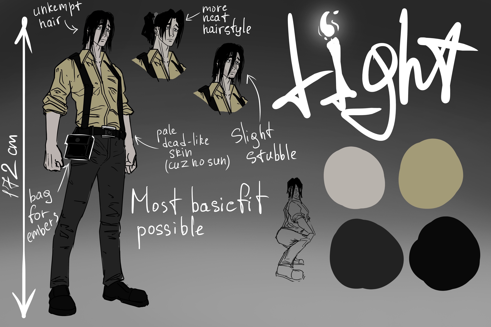
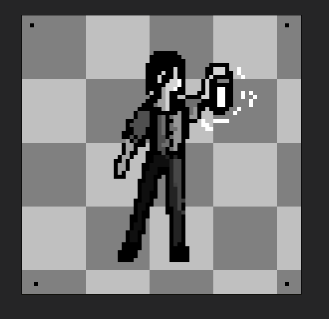
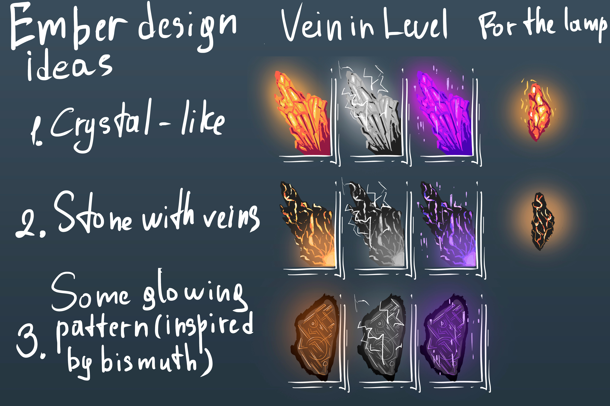

# Maksim — Artist

Use this folder for editable art sources and `exports/` for ready-to-review sprites, tiles, or animations. Use a branch such as `art/maksim/lantern-animation`. Agree the asset assignment with Can before starting.

Record each delivered asset in [the asset register](../ASSET_REGISTER.md). Include a preview and import settings in the pull request.

## Concept gallery

**Artist:** Maksim Martynenko — [@Ichnolith](https://github.com/Ichnolith)

These supplied concept images are preserved at their original resolution and byte content. Filenames are normalized for repository links. They are visual references, not approved runtime sprites or animation sheets. Editable source files and final Unity import settings have not been supplied.

### Light — character concept

6000 × 4000 JPEG. Character silhouette, clothing, hairstyle variants, ember bag, and palette reference.

### Light — pixel art study

660 × 641 PNG. A single character-and-lantern study on a checkerboard presentation background; no animation frames, sprite bounds, pivot, or pixels-per-unit settings are defined.

### Embers — concept exploration

6000 × 4000 JPEG. Crystal, veined stone, and patterned material alternatives, including environment and lantern reference forms. These alternatives do not establish new gameplay states or an approved final material.
