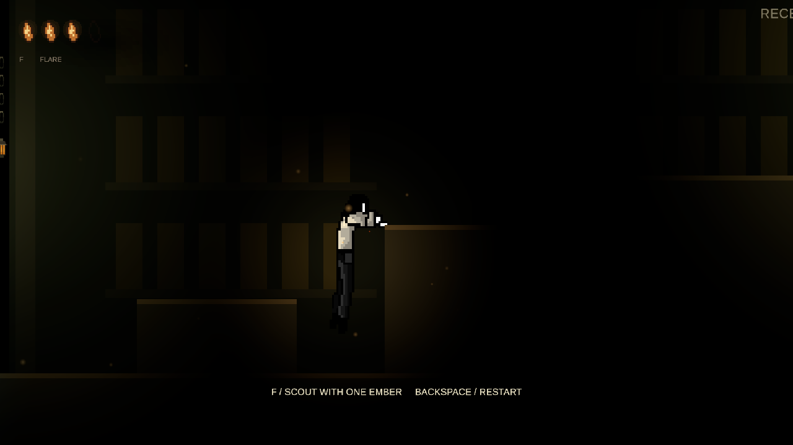

# Ledge-climb contact and recovery — 29 October 2026

The original integration aligned only the horizontal hand reach and advanced the pose separately from the physical path. This let hands slide vertically, feet sink or float across the final pose, and airborne grabs wait through a grounded stow. The revised traversal derives two-dimensional contact markers from Maksim's source pixels and samples every pose from the same fixed-step timeline as the capsule.

- Low ledges choose a later hanging pose; high ledges keep the full start. Grounded preparation remains 0.7 s; airborne grabs skip it. Both use a 0.12 s reach blend.
- Hands remain at the corner through the hanging frames. The leading foot steps onto the ledge while the trailing foot stays outside its face. The standing frames and Idle share a sole baseline.
- A 0.2 s Up buffer catches nearby ledges without repeated presses. Simultaneous horizontal input uses the requested facing, and Jump takes priority before an airborne grab.
- Cancellation preserves the visible foot location and reconciles the capsule only along a checked clear path. Residual visual translation eases out over 0.16 s. Death retains the actual climb pose until respawn. Pause freezes the same clock.
- Completion uses a cached duration and an epsilon, avoiding a rounded end time that could hold the final frame and retain the input lock.

No delivered PNG/JSON, authored scene, mechanism, interaction script, collider size or fuel rule was changed. The existing capsule stays enabled; dynamic/kinematic platforms remain excluded. Static support rotation, removal and a newly obstructed path abort safely. See [traversal controls and authoring limits](PLAYER-TRAVERSAL.md).

## Actual runtime review

Captured the real FurkanTutorial Game view at 1280 × 720 while normal runtime code advanced the traversal. Only the player and camera were positioned for inspection in Play Mode; no authored scene changes were saved. Recordings use the captured timestamps, include no audio, and exclude the initial staging frame before the interpolated Transform catches up. These are contact reviews, not performance benchmarks or full-route completion runs.

- [Grounded climb video](previews/climb-polish/ground-climb.mp4): existing **Second jump / 1.8m** ledge, entry frame 3, Sheathing → Climb → Idle. Finished at approximately **(8.295, 2.605)** with controls restored and all six charges retained.
- [Airborne grab video](previews/climb-polish/air-climb.mp4): existing **Circuit approach** ledge, entry frame 0, immediate Climb → Idle. Finished at approximately **(24.995, 3.205)** with controls restored. An existing nearby pickup adds two charges during this recording; the isolated no-spend assertion is covered by the traversal tests.

[Step-over](previews/climb-polish/step.png) · [Standing baseline](previews/climb-polish/standing.png)

## Verification

Unity **6000.3.2f1**: **141/141 Player tests** (including **22 climb cases**) and **10/10 FirstLight tutorial tests**, with no failures, skips or inconclusive results. This is **151 distinct scoped cases**, not a complete-project run. Render-phase probes verify grip error <0.045 units, standing sole gap <0.065, trailing-foot wall penetration <0.015 and completion sole jump <0.06 in the corresponding regression cases. Controller intent uses synthetic Input System devices; no physical-controller or standalone-build claim is made.

All **15 delivered source hashes** match. A second importer rebuild leaves all **52 checked delivery/generated files** identical, including sprite metadata, preview clips, catalog and prefab. Project integrity passes for **590 tracked assets**. The 26 saved menu-preference keys were restored after testing, and the editor returned to MainMenu outside Play Mode. Unrelated pre-existing font/recovery changes are excluded from this patch. Machine-readable results: [climb-polish-validation.json](climb-polish-validation.json).
