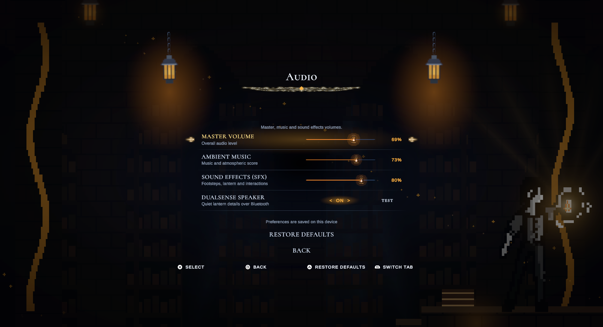

# DualSense Bluetooth speaker

The lantern feedback bindings send ignition, extinguish, ember pickup and ember-break cues to the controller speaker. Normal game audio stays on its normal output. Music and continuous ambience are not forwarded.

## Player controls

**Options → Audio → DualSense Speaker** enables the feature independently of rumble and adaptive triggers. The adjacent **TEST** button plays two notes (660 Hz and 880 Hz) through the controller. It can run while paused; regular gameplay cues cannot.

The test displays a useful message when the feature is off, the mixer is muted, no compatible controller is active, or the game window needs focus. A completed transfer says to listen to the controller; it does not claim that native write acceptance proves audible sound.

Master Volume and Sound Effects both affect the speaker. Zero is a hard mute. The hardware register is capped at 100/127 and uses a perceptual gain curve so ordinary mixer levels are not pushed into a near-silent hardware range. Offline-normalized cue peaks are limited before encoding.

## Current transport

On macOS the implementation uses the compatibility format that produced audible sound on the physical Bluetooth DualSense:

- **State:** standard 78-byte `0x31` report, explicitly selecting speaker-only output (`AudioControl=0x30`). The old `0x00` value selected the headphone route. Speaker volume and output/preamp/mute fields are valid; LED, trigger and headphone-volume fields are not updated.
- **Audio:** 334-byte `0x35` reports, each carrying one 200-byte, 48 kHz stereo CBR Opus packet in subpacket `0x13`. The microphone/duplex capture bit stays clear. This format does not insert silent audio-haptic blocks into the stream.
- **Timing:** nominal 512/48000 seconds per report. Native macOS HID writes can take longer; the scheduler accounts for the write's own blocking time rather than aborting after accumulating 150 ms of lateness. It does not issue catch-up bursts. A 3.5-second per-cue budget bounds stale work.
- **Startup/shutdown:** three state reports initialize the output. After the final audio packet, a cancellable 350 ms drain interval lets the decoder/output queue finish before speaker level zero is sent. A rejected final mute marks the session incomplete.

A dedicated background worker owns the IOKit handles. It never calls Unity, InputSystem or PlayerPrefs from that thread. Routing requires the selected Sony product and serial, or a unique matching Bluetooth device. Missing or ambiguous matches do not address another controller. Packet sequence allocation is synchronized with the motor path.

`DualSenseSpeaker` reads the current application focus instead of retaining an initial focus flag. Pause, scene change, focus loss, suspension, device removal, disable, shutdown and mixer mute cancel output. There is no growing queue; pickups do not interrupt an active cue, and other cues replace it.

The non-Mac HID backend retains its paired-frame `0x39` audio format. USB speaker routing, non-Mac hardware playback and standalone builds have not been verified here. Normal game audio remains available when controller output is unsupported.

## Assets and maintenance

Resources are under `Game/Assets/_Project/Resources/Audio/ControllerSpeaker/`. The `Mac/` variants now contain 140–220 ms of source effect audio with encoded silence around the cue, rather than the old 40–55 ms fragments. The test contains two separated notes. Sources are normalized after filtering and peak-limited, with fades at both ends.

Rebuild with `python3 scripts/audio/build_controller_speaker.py` (ffmpeg/libopus required only for rebuilding). Runtime playback needs no codec library, downloaded program, native plugin or background service. The four game cues derive from the project's existing SFX/procedural extinguish waveform; Preview is a generated two-note calibration cue.

Diagnostics include `LastStatus`, `RequestCount`, `NativeVolume`, `SuccessfulReports`, `FailedReports`, `LastCommandResult`, `LastErrorReportId`, `LastPlaybackComplete` and `IsPlaying`. Complete means the data and drain stage completed; physical listening remains a separate check.

## Verification — 2026-10-26 follow-up

The earlier packet-only checks were insufficient: the user still heard no sound. The follow-up changed the state report, output route, audio format, gain, cue duration and final drain behavior.

- The physical PS5 controller was connected over Bluetooth on macOS. The user explicitly confirmed sound after the `0x31` state + `0x35` audio compatibility probe. That probe had no desktop audio output.
- In Unity 6000.3.2f1, an actual `LanternController.SetFlared(true)` event reached the feedback binding: 35 successful writes, zero failed writes, complete session. Game View was focused through the normal Editor UI; no focus callback was faked.
- 59 Play Mode tests passed: controller/speaker protocol fixtures, complete native payload layout, compatibility frames, mixer/mute/status handling, scheduling after slow writes, missing-device cleanup, thread-safe sequences, real lantern event binding, settings navigation and the existing menu, pause, haptics and chamber-completion tests.
- Independent libopus decoding validated every Mac asset: 240–460 ms decoded duration including padding, RMS 0.078–0.134, peaks below 0.505, no decoding errors. Project integrity passed.
- Existing audio/controller preferences were snapshotted and restored after the test run. Unrelated scene, font and project-setting edits were excluded.

## Audio Quality & Physical Acoustic Refinements — 2026-10-26

To eliminate distortion, buzzing, cone rattle and harsh artificial beeps on the physical DualSense micro-speaker:
1. **Sub-Bass Rattle Elimination (< 440 Hz Cutoff)**: The DualSense speaker enclosure contains a ~15mm ceramic micro-transducer. Driving it with frequencies below 400 Hz causes mechanical cone bottoming-out and severe plastic rattle. We instituted a steep 440 Hz 2-pole highpass across all cues.
2. **Treble Harshness Taming (> 5600 Hz Cutoff)**: A 5600 Hz 2-pole lowpass cuts tinny digital hiss and aliasing, creating a smooth, warm tone.
3. **Limiter Distortion Removed**: Replaced aggressive fast-attack (1ms) brickwall limiting that chopped waveform cycles into distorted square-wave fuzz with a transparent soft limiter (8ms attack, 45ms adaptive release) and clean peak headroom targeting ~0.65 (-3.7 dBFS).
4. **Harmonic Chime Preview**: Replaced sterile microwave-like pure sine beeps with an ethereal, harmonic crystal chime (660 Hz & 880 Hz with musical overtones and exponential decay).
5. **Procedural Flame Dissipation Extinguish**: Replaced the 90 Hz drone with an organic flame dissipation hiss (bandpassed 550 Hz – 2600 Hz) and soft thermal cooling sweep, eliminating bass buzzing.
6. **Precise Transient Framing**: Adjusted `Ignite`, `Pickup`, and `Break` onsets and fade envelopes (12ms in, 40ms out) to eliminate abrupt audio boundary clicks.

## References and notices

Framing references: MIT [DualSense-Bluetooth-Audio](https://github.com/Kodzinho/DualSense-Bluetooth-Audio) and MIT [dualsense-bt-haptics](https://github.com/awalol/dualsense-bt-haptics). Their notices remain in [the prototype notice](licenses/DualSense-Bluetooth-Audio-MIT.txt) and [the upstream notice](licenses/dualsense-bt-haptics-MIT.txt).

The explicit speaker route and standard speaker level are also documented in SDL's [controller audio-route test](https://github.com/libsdl-org/SDL/blob/main/test/testcontroller.c#L438). No external application or driver is installed.

