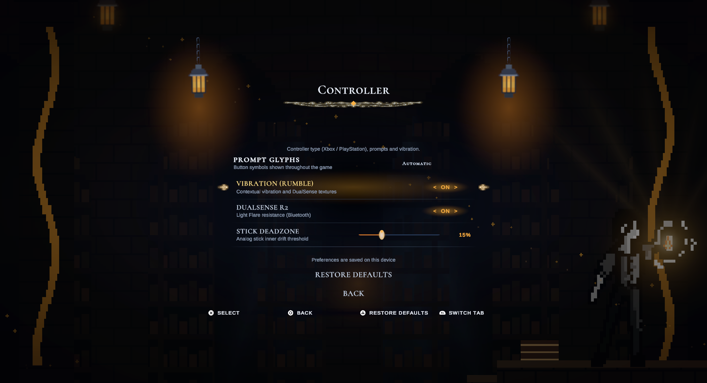

# DualSense textures and adaptive R2

2026-10-26 — Unity 6000.3.2f1 / Input System 1.17.0.

## Distinct feedback

DualSense now uses separate low/high motor envelopes per cue instead of varying only the amplitude of one generic fade. The existing generic gamepad tuning remains available for other controllers. Actual detected hardware selects the texture; changing the displayed button-icon style does not change haptic routing.

| Cue | DualSense texture | Duration |
| --- | --- | ---: |
| Jump | Short, high-motor click | 90 ms |
| Landing | Heavy low-motor impact with a small rebound | 260 ms |
| Flare | Rising, fluttering swell | 650 ms |
| Ember pickup | Two bright clicks with a quiet gap | 250 ms |
| Ember break | Three separated, uneven crackles | 320 ms |
| Death | Low impact and a diminishing high-motor shudder | 550 ms |
| Chamber complete | Two rising, overlapping pulses | 850 ms |
| Settings preview | Left, right, then both motors | 800 ms |

These are custom dual-motor patterns. They are not audio-streamed, full-bandwidth DualSense HD haptics.

## Adaptive trigger

For the project's verified DualSense Bluetooth HID path, Flare and the settings preview also apply **light R2 resistance**. Resistance grows and releases with the cue, begins after the first third of trigger travel and is capped at a low force. There is no L2 force, trigger vibration mode, trigger lock, change to input thresholds, audio configuration or lightbar change.

The existing 78-byte Bluetooth report now optionally enables only the right-trigger effect field. Mode `0x01` supplies light constant resistance and mode `0x05` explicitly releases it. Native command fields, payload length, CRC and motor data remain in one coherent report. Every normal completion and cancellation path sends zero motors and an explicit R2 release, including pause, focus loss, scene change, Vibration off and service shutdown.

**Options → Controller → DualSense R2** independently enables/disables trigger resistance. Vibration is still the master switch; R2 off leaves ordinary vibration available. Both preferences are saved, and defaults preserve chapter progress. The controller options navigation includes the new toggle.

Protocol reference: [SDL's controller test and trigger examples](https://github.com/libsdl-org/SDL/blob/main/test/testcontroller.c), [SDL DualSense effect layout](https://github.com/libsdl-org/SDL/blob/main/src/joystick/hidapi/SDL_hidapi_ps5.c). The Bluetooth backend remains project-local; no driver, package-cache, firmware or unsafe-code setting was changed.

## Validation scope

**46 passed, 0 failed, 0 skipped** in Unity Editor PlayMode. Coverage includes a synthetic DualSense device proving that the service selects its longer Flare texture, all prior haptics/transport/menu/completion cases, the independently saved R2 toggle and its navigation, and the new pattern/trigger tests. The revised Controller page was captured and visually inspected at 2212 × 1199.

Regression coverage samples every texture over its lifetime, checks distinct envelopes and silent gaps, bounds force, verifies explicit R2 release and left-trigger isolation, and checks the adaptive report CRC against an independent Python zlib fixture. Existing Bluetooth transport, settings, lifecycle and chamber tests are also run.

The previous plain Bluetooth rumble pulse was physically confirmed by the user on this Mac/DualSense connection. The new textures and R2 force require a separate subjective hardware check; do not infer HD audio support or complete platform/firmware coverage from native command acceptance.

