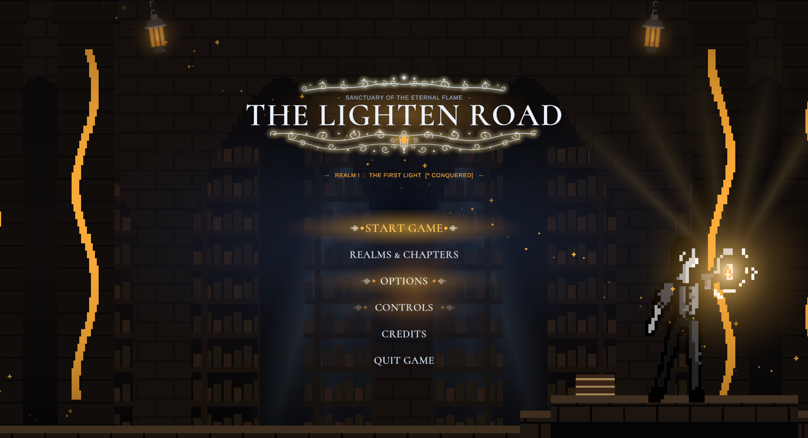
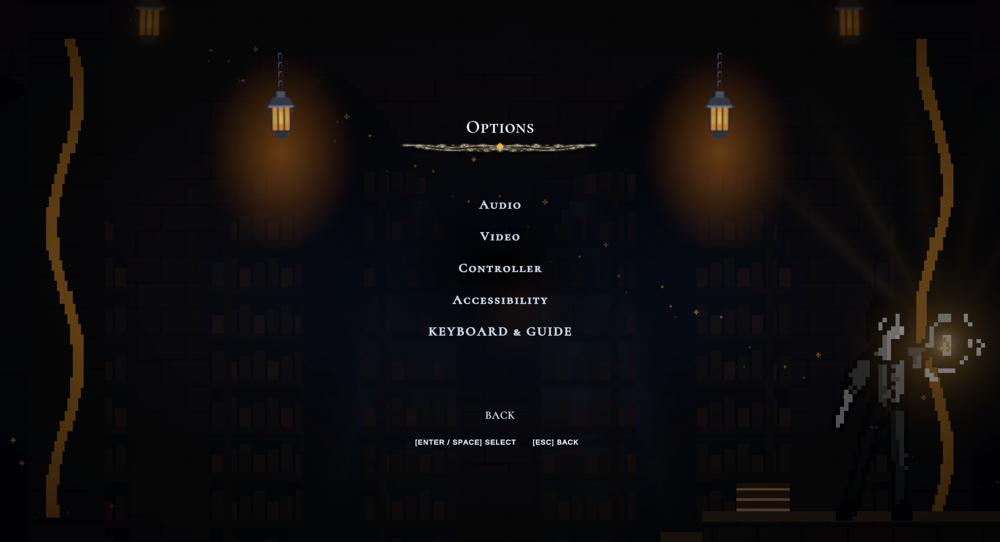
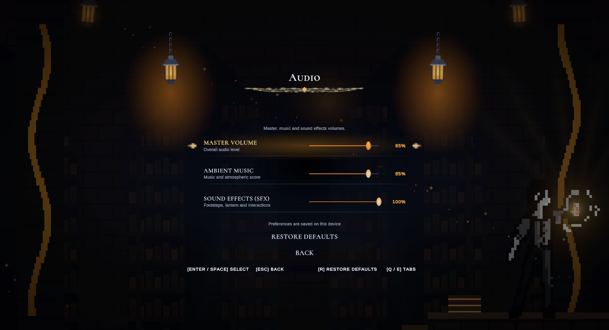
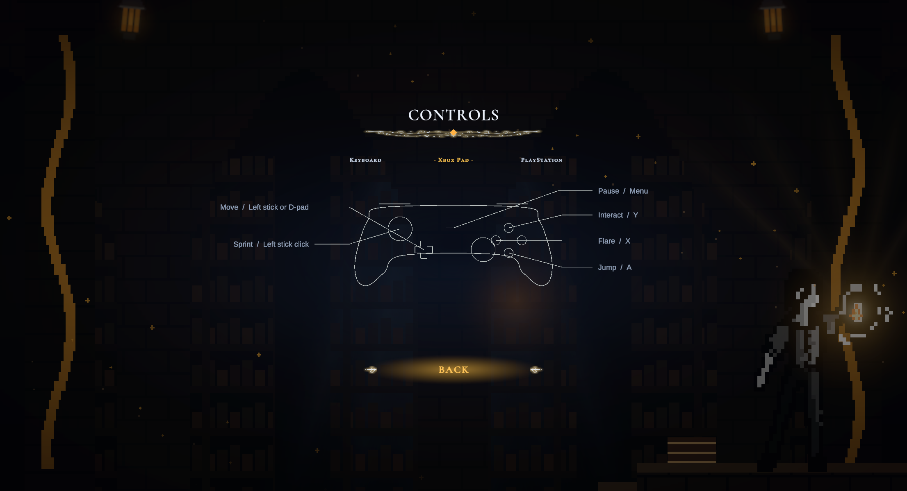
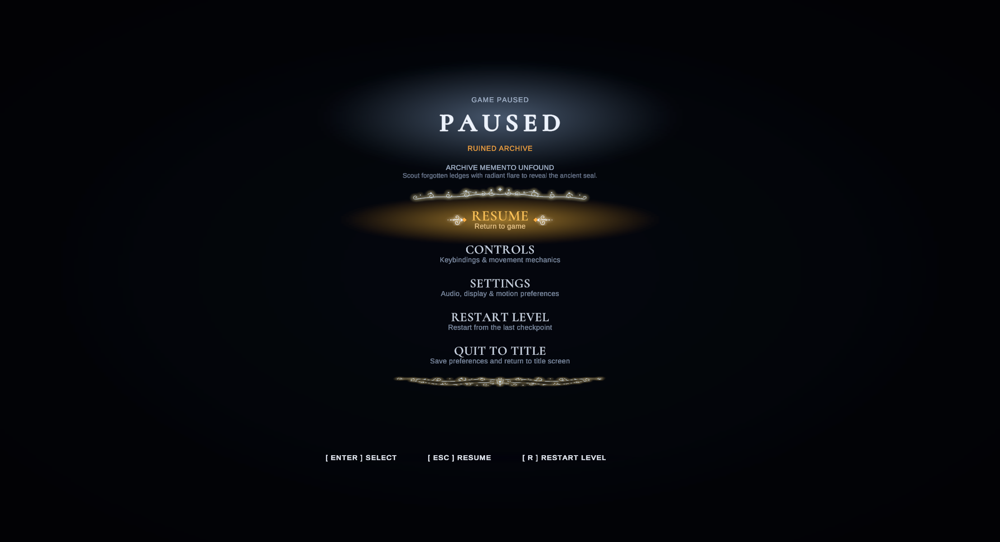

# Archive menus — reference study and implementation

Date: 2026-10-25. Unity 6000.3.2f1. Baseline: `8e9e853`.

## Reference inspection

Inspected actual Hollow Knight screenshots of the title menu, Options index, Audio, Controller, pause menu, profile selection and brightness, via [Interface In Game](https://interfaceingame.com/games/hollow-knight/). These were visual references only, kept outside imported assets and outside this commit.

| Observed reference pattern | The Lighten Road implementation |
| --- | --- |
| Narrow, centered, frameless choices | Serif title/choices with transparent hit surfaces and restrained inward selection ornaments |
| Options index followed by individual pages | Audio, Video, Controller and Accessibility pages; Keyboard & guide links to the existing input guide |
| Clean audio tracks and separate return action | Existing working audio controls, larger labels, separate Restore defaults and Back actions |
| Controller silhouette with action callouts | Original mesh-drawn schematic with asymmetric/symmetric stick layouts and primary game bindings |
| Dark background and restrained transitions | Existing warm archive lamps, ember colors, character art, parallax and reduced-motion preference |

The game's title, archive scene, amber palette, lanterns, chapter progression and input systems remain its own. No Hollow Knight textures, logos, fonts or screenshots are included in the game.

## Interaction changes

- Options now opens a vertical category index. Back/Escape goes from a settings page to that index, then to the title menu. The guide opened from the index returns to Options.
- Keyboard/gamepad selection is activated before the first target is assigned, preventing lost focus when opening a faded-out page.
- Category choices wrap vertically. Individual pages retain explicit navigation and optional Q/E or bumper shortcuts. Disabled frame-limit choices are skipped while V-Sync is active.
- Xbox and PlayStation guide tabs retain their active indication after focus moves away. The schematic is code-rendered and does not intercept pointer input.
- Controller prompt styles, vibration, deadzone, audio persistence, frame limits, reduced motion and progress-safe reset remain available. Bindings shown use primary supported controls; this change does not implement rebinding or change gameplay input.
- Pause shares the new typeface and frameless focus treatment; its settings/guide content is centered. The existing pause control table and quick prompt/rumble options remain.

## Typography and assets

[Cormorant SC SemiBold](../../Game/Assets/_Project/Art/Fonts/ArchiveSerif/README.md) supplies small-cap serif display text; descriptions and diagram labels retain readable sans-serif text. The unmodified source font and SIL OFL license are included with the generated TMP SDF asset. Existing game art and procedurally generated ornaments are reused.

## Validation

Unity Editor PlayMode: **26 passed, 0 failed, 0 skipped**, in two consecutive runs across `MainMenuTests`, `PauseMenuTests` and `ControllerSupportTests` (2026-10-25). Added regressions verify Options back navigation/focus and the controller schematic's rendered mesh/device switching. Existing checks cover volume persistence, V-Sync/frame-limit behavior, chapter-progress preservation on reset, glyph resources, controller settings and pause lifecycle. Test teardown now waits for deferred host destruction before the next menu creates its EventSystem.

Captured and reviewed the title, Options, Audio, Video, controller settings/guide, chapter selection, accessibility, restore confirmation, credits, quit and pause views in the Editor Game view at 2212 × 1199. Project integrity also passed (389 tracked assets). The temporary Editor capture/test harness was removed after verification. The Unity MCP tool endpoint was unavailable in this session; verification used the running Unity Editor and its TestRunner API. The installed MCP package separately logs connection attempts while its external bridge is offline.

This is Editor evidence. No standalone player build, physical Xbox/PlayStation device, ultrawide/mobile layout or screen-reader verification is claimed. Kemal's Interaction, Mechanisms and sandbox files were not changed.

## Current previews

[Video](previews/menu-reference-study/video.png) · [Pause settings](previews/menu-reference-study/pause-settings.png)
