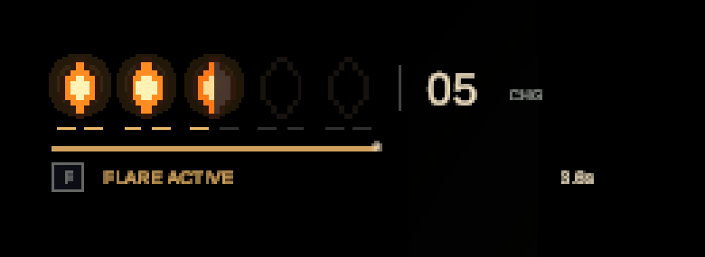
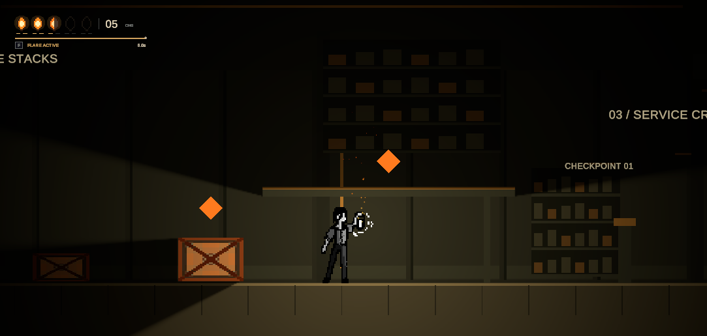
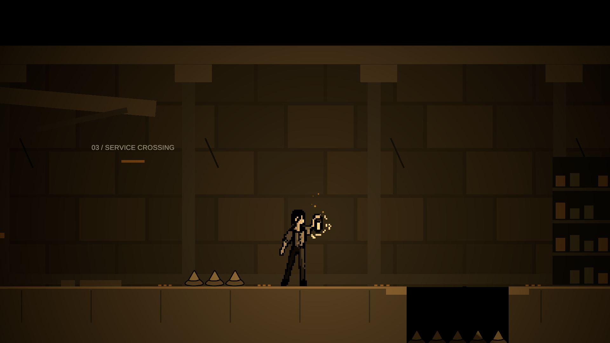
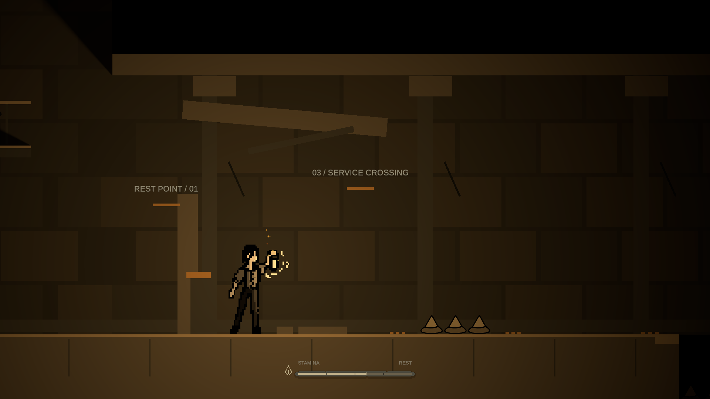
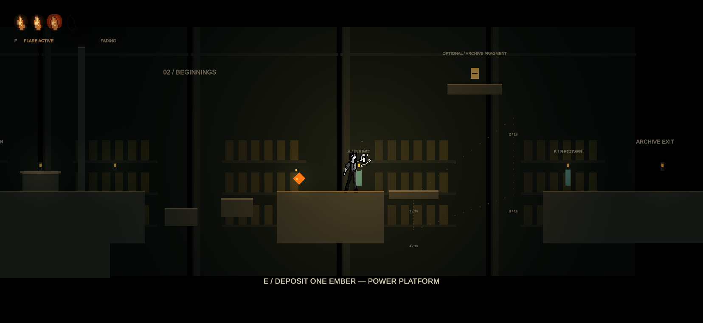
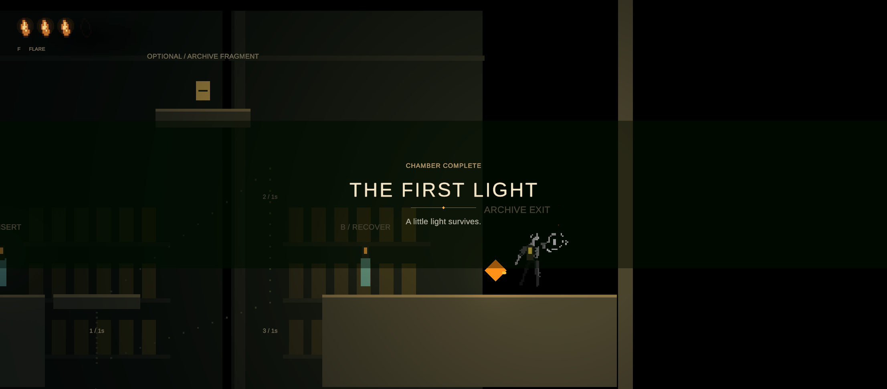

# Siraç — Game Developer

Personal workspace for technical notes and isolated prototypes. The current proposal assigns Siraç the player movement / camera foundation and lantern fuel state / Dim-Flare behavior. The exact scope is in [the developer task split](../../docs/DEVELOPMENT_PLAN.md). Work is developed directly on `main` using scene isolation (`Sandbox/Sirac/`) and script ownership (`Scripts/Player/`, `Lantern/`).

Before starting a system, agree its scope with Kemal. Record its inputs, outputs, and shared dependencies in the task. Move reviewed runtime code into the shared Unity project at `Game/Assets/_Project/Scripts/`.

## Checkpoint 1 — movement and camera (2026-10-15)

Implemented for review in Unity **6000.3.2f1**:

- `PlayerMotor2D`: horizontal movement, grounded detection, a single jump, and collision. Airborne jump presses are discarded.
- `FollowCamera2D`: smooth orthographic camera follow.
- A reusable `PlayerPrototype` prefab with placeholder art and a separate `MovementSandbox` scene containing a floor, boundaries, and three steps.

Open `Game/Assets/_Project/Scenes/Sandbox/Sirac/MovementSandbox.unity` and press Play. Focus the Game view. Move with **A/D or Left/Right**; jump with **Space**. The Input System also binds the gamepad left stick and south button, but a physical gamepad has not been tested. No shared input asset was modified.

Initial tuning is movement speed **5 units/second**, jump velocity **9 units/second**, gravity scale **3**, and ground-check distance **0.06 units**. These are test values, not final balance. The grounded check ignores triggers and rejects side-wall / ceiling normals. The prefab has continuous 2D collision detection, frozen rotation, and a zero-friction / zero-bounce physics material to prevent wall clinging.

### Verification

All **4 Play Mode tests passed** through Unity MCP on 2026-10-15. They instantiate the actual `PlayerPrototype` prefab and exercise the Input System, Rigidbody2D, and colliders: movement in both directions and stopping; one jump with no airborne re-jump plus landing; camera follow; and falling along a side wall while holding toward it. The wall test first reproduced unwanted clinging, which was fixed with the prefab's physics material. The scripts compile without errors.

Tests use a synthetic keyboard and temporarily make test input independent of Editor focus, then restore the previous Input System settings. Normal play still requires focusing the Game view.

Before accepting the movement feel, play the sandbox and check stopping, jump height, platform edges, and camera comfort. Slopes, moving platforms, controller hardware, and final art animation have not been verified. This is a greybox prototype; there is no stage progression or failure flow yet.

## Checkpoint 2 — lantern fuel and Dim / Flare (2026-10-15)

Added to the same sandbox and reusable player prefab:

- `LanternFuel` owns current / maximum fuel, exposes `TrySpendFuel(float)` and `AddFuel(float)` for Kemal's future Power / Drain calls, and raises fuel-changed / depleted events. Spending fails when fuel is insufficient; recovery is capped at capacity and reports the amount accepted.
- `LanternController` toggles Dim / Flare with **F**, applies a warm URP 2D point light, drains fuel in Flare, and returns to Dim at zero. A Game view meter shows the mode and fuel; the light pulses below 25% fuel.
- `EmberPickup` is a reusable trigger prefab that restores a configurable amount. It is consumed only when it restores fuel, so a full lantern leaves it available.
- The sandbox greybox now uses lit sprites and a very low global light, so the lantern changes what is visible.

The sandbox uses **100 fuel capacity**, **80 starting fuel**, a **20-unit pickup**, **0 fuel/second in Dim**, **0.5 fuel/second in Flare**, **2 / 5.5 unit light radii**, and **F** as temporary values. These are inspector-configurable and remain open for review with Kemal and Furkan. There is no death / respawn flow or heartbeat audio yet. The depletion event is the handoff point for a later failure system.

Unity MCP was used to attach the components to the player prefab, create and place the pickup prefab, update and save `MovementSandbox`, and inspect live behavior. From the Game view, moving into the pickup restored fuel from 80 to 100 and removed the pickup; at full fuel the pickup remained. The F key also switched modes while the meter updated. The scene validator found no missing scripts or broken prefabs.

Open the scene in `Game/` using Unity 6000.3.2f1 and press Play. Focus Game view; move with **A/D or Left/Right**, jump with **Space**, and press **F** to switch the lantern. The visible meter and glow provide the current review surface.

## Checkpoint 3 — assembly definition, API refinement, and automated tests (2026-10-15)

Strengthened the lantern foundation for team integration and automated testing:

- **Assembly Definition (`TheLightenRoad.Lantern`):** Separated lantern code into its own assembly referencing `Unity.InputSystem`, `Unity.RenderPipelines.Universal.Runtime`, and `Unity.RenderPipelines.Universal.2D.Runtime`. This allows Kemal's future `TheLightenRoad.Interaction` and `TheLightenRoad.Mechanisms` assemblies to reference the lantern API directly without relying on `Assembly-CSharp`.
- **API additions for Kemal's Power / Drain system:**
  - `LanternFuel.CanSpendFuel(float amount)`: non-mutating check so interaction prompts can preview whether an Ember Vein Power interaction is affordable.
  - `LanternFuel.IsFull` and `LanternFuel.IsEmpty`: clean status queries.
  - `LanternFuel.Initialize(float current, float capacity)`: runtime reconfiguration for test fixtures and stage transitions (cumulative fuel carryover between chambers).
  - `LanternFuel.SetDrainRates(float dimDrain, float flareDrain)`: configurable drain rates.
  - Accessors for starting fuel, drain rates, low-fuel status (`LanternController.IsLowFuel`), low-fuel threshold, toggle key, and pickup amount/collection status (`EmberPickup.FuelAmount`, `EmberPickup.IsCollected`, `EmberPickup.SetFuelAmount`).
- **Comprehensive automated test coverage (22 Play Mode tests, all passed):**
  - `LanternFuelTests` (11 tests): default initialization; custom initialization with non-positive capacity rejection; `TrySpendFuel` deduction, failure, and negative amount rejection; `CanSpendFuel` queries; `AddFuel` capping at capacity, zero return when full, and negative amount rejection; `FuelChanged` and `FuelDepleted` event dispatches; and `TickLanternDrain` consumption across Dim and Flare.
  - `LanternControllerTests` (4 tests): Dim / Flare mode toggle and zero-fuel rejection; auto-revert from Flare to Dim when fuel depletes; low-fuel threshold detection; and synthetic keyboard **F** key input toggle.
  - `EmberPickupTests` (3 tests): exercises the actual `PlayerPrototype` and `EmberPickup` prefabs; confirms 80 to 100 fuel restoration and pickup destruction upon contact; confirms pickup is preserved when lantern is full; and confirms non-player colliders are ignored.
  - `PlayerMotor2DTests` (4 existing tests re-verified): horizontal movement, single grounded jump and airborne rejection, side-wall non-clinging, and camera follow.

### Live Verification

Verified in Unity 6000.3.2f1 via Unity MCP:
- All **22 Play Mode tests passed** (`TestResults.xml` recorded duration ~5.4s).
- Scene validation for `MovementSandbox.unity`: **0 missing scripts, 0 broken prefabs, 0 issues**.
- Unity console: **0 compile errors, 0 warnings**.

## Checkpoint 4 — pixel-art lantern HUD (2026-10-16)

Replaced the legacy debug IMGUI overlay with a fully procedural pixel-art HUD rendered via a pixel-perfect Screen Space Overlay Canvas (reference resolution $640 \times 360$):

- **Component & Assembly (`LanternHUD.cs`, `TheLightenRoad.UI`):**
  - Modular UI assembly cleanly referencing `TheLightenRoad.Lantern`, `UnityEngine.UI`, and `Unity.InputSystem`.
  - Automatically binds to the active player's `LanternController` and listens to `FuelChanged`, `FuelDepleted`, and `FlareChanged` events.
- **Visual Features:**
  - **Procedural Pixel-Art Lantern (`PixelSprites.cs`):** 11×15 brass lantern casing with an animated multi-harmonic flame, glass reflections, and a radial warm glow halo that intensifies during Flare mode.
  - **Segmented Fuel Bar & Drain Trail:** 20 distinct segments with pixel-snapped horizontal filling. Includes a two-phase drain trail (white-amber lag) so energy consumption is readable at a glance.
  - **Dynamic Palette Shift & Low Fuel Warning:** Healthy amber at high capacity, shifting toward hot orange and warning red as fuel diminishes. Below 25% capacity, the border and flame pulse with a heartbeat rhythm, and labels switch to `DIM LOW` / `FLARE LOW`.
  - **Mode Indicator & Input Key Hint:** Crisp labels displaying current mode (`DIM`, `FLARE`, `EMPTY`) along with the configurable toggle key binding (`[F]`).
  - **Pickup & Depletion Feedback:** Floating `+20` popup indicator upon collecting Ember Pickups and a pixel-snapped screen shake when fuel reaches zero.
- **Legacy IMGUI Overlay:** Gated behind `LanternController.ShowDebugOverlay` (disabled by default) to keep production builds clean while preserving debugging capabilities.

### Automated Test Coverage (28 Play Mode tests, all passed)

- Added 6 new automated tests in `LanternHUDTests.cs`:
  - `BuildsOverlayCanvasAndShowsCurrentFuel`: verifies canvas hierarchy construction, controller binding, percentage, and initial fill.
  - `DisplayedFillEasesDownWhileTrailLingers`: confirms the two-stage visual drain trail.
  - `FlareModeUpdatesLabel`: verifies real-time UI reaction to mode toggles.
  - `LowAndEmptyFuelAreFlagged`: confirms low-fuel threshold detection and empty status.
  - `FuelGainShowsPickupFeedback`: verifies the animated pickup feedback.
  - `LegacyDebugOverlayIsOffByDefault`: verifies IMGUI overlay is disabled by default.
- All **28 Play Mode tests passing** in Unity Test Runner.

## Checkpoint 5 — platformer game feel and juice (2026-10-16)

Elevated movement responsiveness in `PlayerMotor2D.cs` with classic high-feel platformer mechanics:

- **Coyote Time (`0.15s`):**
  - Allows jumping within a $0.15$-second window after walking off a platform ledge into midair. Eliminates the frustrating "missed jump" feeling at platform edges.
  - Automatically resets upon jump execution so airborne double jumps remain impossible.
- **Jump Buffering (`0.12s`):**
  - Remembers jump presses initiated within $0.12$ seconds before touching the ground, automatically triggering an immediate jump the exact frame the player lands.
- **Variable Jump Height (Jump Cut `0.5x`):**
  - Releasing Space early while ascending cuts upward velocity in half, allowing players to perform snappy short hops over obstacles or full-height jumps by holding the button.
- **Automatic Sprite Flipping:**
  - Automatically updates `FacingDirection` and sets `SpriteRenderer.flipX` based on horizontal movement input with deadzone filtering.
- **Procedural Squash & Stretch:**
  - Adds visual-only spring deformation on `visualTransform` without distorting the physical `CapsuleCollider2D`:
    - **Takeoff Stretch:** Stretches vertically (`0.85x, 1.25y`) to convey upward energy.
    - **Landing Squash:** Compresses vertically on ground contact (`1.25x, 0.75y`) to convey weight and momentum.
    - Smoothly recovers toward base scale via configurable recovery speed (`squashRecoverySpeed = 9`).

### Automated Test Coverage (32 Play Mode tests, all passed)

- Added 4 new Play Mode tests in `PlayerMotor2DTests.cs`:
  - `MovementInputFlipsSpriteDirection`: verifies `FacingDirection` and `SpriteRenderer.flipX` reaction to left/right input.
  - `CoyoteTimeAllowsJumpShortlyAfterLeavingLedge`: verifies walking past a ledge boundary and executing a jump in midair.
  - `JumpBufferExecutesUponLanding`: verifies pre-landing jump buffering and immediate takeoff on contact.
  - `VisualSquashAndStretchReactsToJump`: verifies vertical stretch on jump initiation and smooth recovery.
- Total **32 Play Mode tests** covering player motor, camera, lantern fuel, dim/flare controller, ember pickups, and HUD.

## Checkpoint 6 — 2D dynamic shadows and organic flame flicker (2026-10-16)

Integrated real-time 2D shadow casting and atmospheric flame undulation into `MovementSandbox.unity` and `LanternController.cs`:

- **2D Dynamic Shadow Casters:**
  - Attached `ShadowCaster2D` to all obstacles and boundaries in `MovementSandbox.unity` (`Step 01`, `Step 02`, `Step 03`, `Left Boundary`, `Right Boundary`).
  - Obstacles now cast crisp, dramatic 2D occlusion shadows across the floor and walls as the player moves with the lantern.
  - Added `ShadowSetupUtility.cs` under `Editor/` providing a 1-click Unity menu item (`Tools -> The Lighten Road -> Setup 2D Dynamic Shadows`) to automatically inspect, attach, and configure `ShadowCaster2D` on any active scene.
- **Organic Flame Flicker:**
  - Added continuous Perlin-noise-driven flame modulation to `LanternController.cs`:
    - Simulates subtle, organic breathing of the flame (`flickerIntensity = 0.04`, `flickerRadius = 0.05`, `flickerSpeed = 8`).
    - Dynamic shadows subtly shift and dance in real-time, elevating the subterranean ruin atmosphere from static lighting to an immersive living torchlight feel.
- **Inspector Tuning Parameters (`LanternController.cs` & `PlayerPrototype.prefab`):**
  - Configurable `enableShadows` toggle, `shadowIntensity` ($0.85$), and `shadowSoftness` ($0.25$).
  - Configurable `enableFlicker` toggle, intensity, and speed.

### Automated Test Coverage (33 Play Mode tests)

- Added automated test in `LanternControllerTests.cs` verifying dynamic shadow and organic flicker property configuration.
- Total **33 Play Mode tests** covering player motor, game feel, camera, lantern fuel, dim/flare controller, shadows/flicker, ember pickups, and HUD.

## Checkpoint 7 — Atmospheric Particle FX: Ambient Dust Motes, Lantern Sparks, and Footstep Dust (2026-10-16)

Elevated subterranean ruin immersion with three reactive 2D particle systems using URP 2D Lit and Unlit shaders:

- **1. Ambient Dust Motes (`DustMotesAtmosphere.cs`):**
  - Ethereal motes lazily drifting across the sandbox environment (`areaSize = (26, 14)`).
  - Uses `Universal Render Pipeline/2D/Sprite-Lit-Default` with soft circular gradient particles.
  - In darkness, motes are almost imperceptible; when illuminated by the player's lantern `Light2D`, they ignite into sparkling warm amber motes, providing breathtaking depth and illumination feedback.
  - Perlin noise turbulence module provides gentle, organic subterranean air currents.
- **2. Lantern Sparks & Embers (`LanternSparksFX.cs`):**
  - Hot fire sparks and embers rising from the lantern flame into the air.
  - Simulated in **World Space**: when the player walks or runs, embers trail behind organically instead of staying locked to the player transform.
  - **Dim Mode:** Calm, slow embers ($4\text{ sparks/s}$, gentle upward float).
  - **Flare Mode (Shift):** Energetic fiery blast ($22\text{ sparks/s}$, faster speed, wider cone, bright yellow-white to deep crimson-ember color over lifetime).
  - **Zero Fuel:** Flame dies and spark emission immediately ceases when fuel reaches 0.
- **3. Footstep & Movement Dust (`PlayerFootstepDustFX.cs`):**
  - Ground movement and kinetic impacts emit subtle dust puffs at the player's feet:
    - **Run Dust:** Emits tiny dust puffs kicking backwards away from `FacingDirection` while moving on stone ground.
    - **Jump Puff:** Bursts outwards horizontally upon takeoff.
    - **Landing Shockwave:** Expanding dust cloud upon touchdown with particle count and velocity scaling dynamically with landing impact velocity.
- **Editor Tooling & Asset Pipelines:**
  - Procedural soft textures (`Particle_SoftCircle.png`, `Particle_Spark.png`, `Particle_DustPuff.png`) and fallback procedural generator (`ParticleTextures.cs`).
  - Added 1-click Editor utility: `Tools -> The Lighten Road -> Setup Atmospheric Particle Effects` in `EffectsSetupUtility.cs`.

### Automated Test Coverage (36 Play Mode tests)

- Added `ParticleEffectsTests.cs` verifying:
  - `DustMotesAtmosphereInitializesAndConfiguresModules`: verifies ParticleSystem creation, box shape, world simulation space, and emission.
  - `LanternSparksFXRespondsToDimAndFlare`: verifies emission rate boost during Flare mode and shutdown on fuel depletion.
  - `PlayerFootstepDustFXInitializesChildSystems`: verifies dynamic instantiation of run dust and burst particle child systems.
- Total **36 Play Mode tests** across player motor, game feel, camera, lantern fuel, dim/flare controller, shadows/flicker, atmospheric particle FX, ember pickups, and HUD.

## Checkpoint 8 — Cinematic Platformer Camera: Look-Ahead, Fall Anticipation, and Landing Shake (2026-10-16)

Elevated camera feel in `FollowCamera2D.cs` with dynamic, responsive platformer tracking tailored to dark subterranean exploration:

- **Horizontal Look-Ahead (`lookAheadDistance = 0.85`, `idleLookAheadDistance = 0.35`):**
  - While running left/right, the camera smoothly leads ahead of the player by $0.85$ units over $0.25$ seconds, eliminating the feeling of moving blindly into the darkness.
  - While stationary, the camera gently settles $0.35$ units ahead in the player's facing direction, giving players a broader view of what lies ahead in their lantern's beam.
- **Vertical Fall Anticipation (`fallLeadDistance = 1.2`, `fallVelocityThreshold = -3.5`):**
  - When descending rapidly off ledges or falling past the $-3.5\text{ m/s}$ threshold, the camera leads downward by up to $1.2$ units.
  - Players can inspect the floor, platforms, or potential hazards below before touching down.
  - Upon landing or grounded recovery, the vertical offset smoothly dampens back to the neutral height ($+1.5$).
- **Impact Screen Shake & Juice (`landingShakeIntensity = 0.08`, `minShakeImpactSpeed = 8`):**
  - Listens to `PlayerMotor2D.OnLanded`: heavy touchdowns from high falls trigger a subtle, punchy procedural camera shake ($0.12\text{s}$).
  - Exposes `Shake(float intensity, float duration)` for manual screen shake invocation (usable by hazards, explosions, or fuel depletion).
  - Shaking is separated from the smooth damping path (`currentFollowPosition + shakeOffset`), ensuring zero jitter in the core follow tracking.
- **Backwards Compatibility & Safety:**
  - Preserves all previous serialized fields (`target`, `offset`, `smoothTime`), ensuring Kemal's `SceneKemal.unity` continues functioning seamlessly without modifications.
  - Works on any target: automatically hooks into `PlayerMotor2D` and `Rigidbody2D` when present, falling back to delta tracking otherwise.

### Automated Test Coverage (40 Play Mode tests)

- Added 4 new Play Mode tests in `FollowCamera2DTests.cs`:
  - `FollowCameraSnapsAndTracksTargetWithOffset`: confirms snapping, base tracking, and offset alignment.
  - `CameraLeadsAheadWhenTargetMovesHorizontally`: verifies positive X leading when moving right and negative X leading when moving left.
  - `CameraAnticipatesFallWhenDescendingRapidly`: verifies downward camera shift when descending with high downward velocity.
  - `CameraShakeActivatesAndDecays`: verifies shake activation, duration timer, and smooth decay to neutral.
- Total **40 Play Mode tests** covering player motor, game feel, camera follow & cinematic juice, lantern fuel, dim/flare controller, shadows/flicker, atmospheric particle FX, ember pickups, and HUD.

### Next checkpoint

## Checkpoint 9 — Death & Respawn Loop with Atmospheric UI/UX (2026-10-16)

Implemented the failure state and retry flow specified in GDD Section 5.3 & 6.2 ("At zero fuel: Trigger the designed failure and respawn flow"):

- **`PlayerRespawnController.cs` (`TheLightenRoad.Player`):**
  - Manages player mortality state machine (`Alive`, `Dying`, `Dead`, `Respawning`).
  - **Darkness Depletion:** Automatically listens to `LanternFuel.FuelDepleted` when fuel drops to 0. Extinguishes the lantern and freezes motor input and physics simulation.
  - **Void / Fall Detection:** Checks vertical position against configurable `voidKillY` threshold (`-5.5`).
  - **Respawn Flow:** Teleports player to active checkpoint/spawn position (`-5, 1, 0`), re-initializes lantern fuel to baseline (`80` fuel), re-ignites lantern, resets camera, and smoothly restores player mobility.
  - **Input Flexibility:** Features an automatic countdown timer (`autoRespawnDelay = 2.4s`) with manual skip support ([Space], [Enter], [R], or Gamepad South) to instantly respawn.
- **`DeathScreenOverlay.cs` & `PixelSprites.cs` (`TheLightenRoad.UI`):**
  - Procedural high-order Screen Space Overlay Canvas (`sortingOrder = 200`, reference resolution $640 \times 360$).
  - **Encroaching Vignette:** Stepped pixel-art radial darkness texture closing in as the character is consumed by the dark.
  - **Void Blackout:** Deep void curtain (`#06070a`) fading over gameplay.
  - **Contextual Lore Messages & Icons:**
    - Darkness: Extinguished flame wisp icon, `"KARANLIKTA KAYBOLDUN"`, *"Fenerin alevi söndü... Karanlık seni yuttu."*
    - Void: Pixel skull icon, `"DİPSİZ KUYUYA DÜŞTÜN"`, *"Eski dünyanın derinliklerinde kayboldun."*
    - Hazard: `"YOK OLDUN"`, *"Harabelerin ölümcül tehlikesi seni yakaladı."*
  - **Animated Prompt & Countdown Bar:** Breathes with a warm amber pulse (`[SPACE] / [R] Yeniden Doğ`) and displays a smooth horizontal countdown progress bar.
  - **Rekindling Flash:** On respawn, a warm golden-orange radial bloom flashes from the center as the lantern's flame bursts back to life.
- **`HazardTrigger2D.cs` (`TheLightenRoad.Player`):**
  - Modular trigger component for environmental dangers and void zones. Added a $50$-unit wide `Void Pit` trigger at $Y = -6$ in `MovementSandbox.unity`.

### Automated Test Coverage (44 Play Mode tests)

- Added 4 new Play Mode tests in `PlayerRespawnTests.cs`:
  - `DepletedFuelTriggersDarknessDeath`: verifies death state, motor shutdown, and overlay activation upon fuel depletion.
  - `FallingBelowVoidLimitTriggersVoidDeath`: verifies void limit detection.
  - `HazardTriggerKillsPlayerOnContact`: verifies `HazardTrigger2D` collision trigger.
  - `RespawnRestoresPlayerFuelPositionAndMotor`: verifies complete restoration of player position, 80 fuel, and movement capabilities.
- Total **44 Play Mode tests** across player motor, game feel, camera follow & cinematic juice, lantern fuel, dim/flare controller, shadows/flicker, atmospheric particle FX, death/respawn loop, ember pickups, and HUD.

### Next checkpoint

## Checkpoint 10 — Game Designer Furkan Feedback #1: Discrete Ember Economy, RPG HUD, Office Room Scale, and 100% Darkness (2026-10-16)

Resolved all design points from GitHub Issue #1 (`F_Feedback#1`) opened by Game Designer Furkan Aydın (`@aeshmacodex`):

- **1. Level Design — Human Office Scale & Dynamic Ceiling Shadows:**
  - Real human office proportions: ceiling is positioned ~1 body height above the player ($1.6\text{m}$ character $\rightarrow$ ceiling bottom at $Y = 3.2\text{m}$, top at $Y = 3.45\text{m}$).
  - Added an office doorway partition leaving a $1.7\text{m}$ clearance door.
  - Equipped with `ShadowCaster2D` and URP 2D Lit materials, allowing the lantern's light to hit the ceiling directly and cast dramatic upward and doorway shadows.
- **2. 100% Pitch Black Stage Darkness:**
  - `Global Light 2D` in `MovementSandbox.unity` set to pure black `{r: 0, g: 0, b: 0, a: 1}` and `intensity = 0` (0% ambient light, true pitch darkness instead of 80% opacity).
- **3. Infinite Baseline Dim Light:**
  - The character **always** has an infinite baseline light resource in hand; `dimDrainPerSecond = 0f`.
  - The lantern will never run out of light naturally in Dim mode.
- **4. Tuned Light Radii (50% & 200% of previous Flare):**
  - **Dim Radius:** $2.75\text{ units}$ ($50\%$ of previous $5.5$).
  - **Flare Radius:** $11.0\text{ units}$ ($200\%$ of previous $5.5$).
  - **Intensities:** Dim $= 0.55$, Flare $= 1.25$.
- **5. Discrete Ember Economy & RPG Health-Bar HUD (`LanternHUD.cs` & `PixelSprites.cs`):**
  - Replaced continuous fuel gauge with an RPG HP-bar style layout in the top-left corner.
  - **5 Discrete Slots:** Displays up to 5 ember crystal sockets horizontally:
    - **Full Ember:** 2 charges (bright amber crystal with white-hot core).
    - **Half Ember:** 1 charge (cracked ember stone with half charge remaining).
    - **Empty Socket:** 0 charges (dark bronze socket frame).
  - **Timed Scout Pulse:** Pressing `[F]` spends 1 charge (`TrySpendCharge()`) and flares the lantern for a $6.0\text{s}$ timed scout pulse, then automatically dampens back to infinite Dim.
  - **Dynamic `+N` Overflow Badge:** Inventory capacity expands dynamically. When total embers exceed 5, a golden `+1`, `+2`, `+N` badge appears to the right of the 5th icon (e.g., 9 embers $= 5$ icons $+ 4$ badge).
  - **Always-Collected Pickups:** Pickups (`EmberPickup.cs`) are **always** collected into inventory regardless of current count (never rejected).
  - **HUD Feedback:** Shows live scout timer countdown (`ALEV İZCİSİ (4.2s)`), empty state warning (`[F] KOR TÜKENDİ`), and floating pickup feedback (`+1 KOR`).
- **6. Character Animations:**
  - Preserved existing sprite setup without touching animation clips or controllers, respecting Furkan's note that animations are assigned to artists Can & Maksim.

### Automated Test Coverage (45 Play Mode tests)

- Updated and expanded test suites across all affected modules:
  - `LanternHUDTests.cs`: 6 tests verifying 5-slot hierarchy, Full/Half/Empty visual states, `+N` overflow badge, Flare scout label/timer, empty state, and pickup feedback popup.
  - `EmberPickupTests.cs`: 3 tests verifying charge increments, always-collected overflow behavior, and non-player trigger filtering.
  - `LanternFuelTests.cs`: 12 tests verifying discrete ember properties (`TotalCharges`, `TotalEmbers`, `FullEmbers`, `HasHalfEmber`, `OverflowEmbers`), charge deductions, and infinite Dim drain.
  - `LanternControllerTests.cs`: 6 tests verifying $2.75$ / $11.0$ radii, timed scout expenditure, low-fuel threshold, and shadow settings.
- **100% Pass Rate: 45 / 45 Play Mode tests passing.**

### Next checkpoint

Continue expanding player systems in `Sandbox/Sirac/`:
1. Procedural 8-bit audio feedback / sound synthesis for footsteps, jumps, flame ignition, and low-fuel heartbeat.
2. Secret wall runes / glyphs that only reveal when illuminated by Flare mode.

## Checkpoint 11 — Minimal animated ember HUD (2026-10-16)

Rebuilt `LanternHUD` as a compact, borderless overlay (210 × 54 at a 960 × 540 reference resolution). The five existing crystal sprites show full / half / empty embers, with two fine charge marks per crystal, an exact charge count, and overflow inventory. A small key hint uses the controller's configured input; an active scout shows its remaining seconds and a thin time indicator.

Motion is limited to a short staggered entrance, subtle ember breathing, a brief gain / spend response, and a fading pickup receipt. `Reduce Motion` disables decorative movement while retaining state feedback. The HUD does not change gameplay fuel, scout duration, pickups, or death / respawn. A resource-backed TextMesh Pro SDF font uses the already included OFL Liberation Sans source and includes Turkish glyphs.

Validation: all 11 `LanternHUDTests` passed through Unity MCP, covering full / half / empty states, overflow, scout tracking without extra fuel spending, pickup feedback including single charges, disable / re-enable, reduced motion, and retargeting. Dim and Flare were also inspected in Unity Game view. The remaining gameplay suites were not rerun for this UI change.

All current player-facing UI is in English: ember / charge counts, pickup receipts, Flare prompts, timers, empty reserve feedback, death messages, and respawn instructions. HUD timers use English decimal formatting regardless of the system locale.

English UI verification: 15 / 15 Play Mode tests passed (11 HUD + 4 player respawn); the English Flare HUD was visually checked and the live hazard overlay displayed English death and respawn messages.

## Checkpoint 12 — Archive test chamber (2026-10-16)

Open `Game/Assets/_Project/Scenes/Sandbox/Sirac/ArchiveTestChamber.unity`. This separate 70m-wide blockout contains an intake, archive shelves and optional mezzanine, a service crossing, a blackout corridor, and an exit. Three 2m trenches test jump clearance and failure recovery; checkpoint triggers at x=14 and x=32.5 keep retries local. Eight ember pickups exercise resource collection and the HUD. Backspace resets the whole test route, including pickups and checkpoints.

All new scene support code, tests, typography, and materials live under `Scenes/Sandbox/Sirac/TestChamber/`. Existing player and pickup prefabs are instantiated without modifying their sources. Kemal's scene, development folders, interactions, and machinery are unchanged. No shared build setting was added.

Verified through Unity MCP in 6000.3.2f1: all three `ArchiveTestChamberTests` passed. The actual authored map was completed using synthetic A/D and single-jump input with no deaths; trench death returned the player to Checkpoint 01 with six charges; Backspace restored all eight pickups and the starting state. Scene validation found zero missing scripts and zero broken prefabs. This is a test blockout, not the completed Office MVP or a human completion-time result.

## Checkpoint 13 — The Ruined Archive (2026-10-16)

Rebuilt the current `MovementSandbox` as a 72m ruin route with an optional upper office, three ember reserves, two checkpoints, progressive spike encounters and two 2.2m bridge gaps. The supplied five-spike JPEG was prepared as a transparent sprite strip; provenance, extraction prompt, positions and editing instructions are in the [level notes](../../Game/Assets/_Project/Scenes/Sandbox/Sirac/LevelMap/README.md). Shadow casters use the unscaled collider parents so Flare illumination remains correct. Art is a prototype blockout.

All three new real-scene Play Mode tests passed: the main route without fuel or deaths, the office reward, and spike / checkpoint / reset behavior. Existing player tuning, audio, shared prefabs and Kemal's work are preserved.

## Checkpoint 14 — Etched stamina instrument (2026-10-16)

Replaced the bottom stamina pill with a thin engraved iron channel, muted ivory reserve, quarter etches, breath mark and quiet English state labels. Drain leaves a delayed trail; exhaustion uses fired-clay color and a restrained pulse; recovery adds a short glint. The instrument smoothly enters when needed and fades below the screen after resting at full reserve. Reduce Motion removes decorative movement and uses instant visibility changes. Safe-area bottom insets are respected. No stamina costs, regeneration or movement tuning changed.

All seven stamina HUD tests passed, covering reserve binding, drain trail, exhaustion recovery, gradual visibility, reduced motion, disable/re-enable and reset. Actual Unity rendering was inspected at 1920×1080 in Dim and Flare, including exhaustion. These focused preview captures render the stamina canvas with the gameplay camera; other overlay HUDs are omitted from the captures.

The complete three-assembly run passed 79/81. The camera lead timing test passed in isolation afterward; the older ArchiveTestChamber traversal remains failing with current tuning (six deaths at x=34.85). Its scene and traversal test were left unchanged. No standalone build or physical controller verification was performed.

## Checkpoint 15 — Animated main menu (2026-10-17)

Added the approved dark archive / warm lantern direction with a 3.7-second skippable opening, restrained camera drift, ash, animated focus indicators and panel fades. Play, Settings, Credits and confirmed Quit work. Master / music / SFX levels, fullscreen and reduced motion are saved; a menu-owned service applies audio and HUD preferences after entering gameplay. The first build scene is now MainMenu, followed by MovementSandbox; SampleScene remains available.

All three new Play Mode menu tests passed in Unity 6000.3.2f1 through Unity MCP. Actual Home and Settings views were inspected and the user approved the design. The asynchronous Play transition was checked against the actual gameplay scene. Standalone fullscreen, physical gamepad behavior and a standalone build were not verified. See the [menu notes and asset provenance](../../Game/Assets/_Project/Scenes/Frontend/README.md).

Repository integrity check: four existing files in Interaction / Mechanisms (`EmberVein.cs`, `ElectrifiedWater.cs`, `RollingShelf.cs`, `SimpleLift.cs`) fail UTF-8 decoding, including in the pre-menu HEAD. Those ownership-protected files were not changed in this menu commit. All new menu assets passed the integrity checks.

## Checkpoint 16 — Three-ember chamber rules (2026-10-18)

Applied the updated developer contract and the owner's clarification that the player can carry at most three embers. Full-inventory pickups stay in the world. A Flare spends one whole ember permanently and animates its fade/crack in one use. Dim requires held fuel; more than three continuous seconds at zero held fuel causes Darkness death. Recovery cancels the timer. Chamber entry and respawn restore three embers, and the existing Siraç route checkpoint API now begins a chamber segment.

Legacy two-charge APIs remain compatible with the mechanism owner. Kemal's scripts and scenes were inspected only. The [developer contract and integration review](../../docs/DEVELOPER-MECHANICS-2026-10-18.md) records waypoint patrol, gravity descent, shared multi-node state, full-lantern recovery safety, and world-state reset work still needed in that domain.

Unity MCP Play Mode validation: 62/62 focused player/fuel/HUD/pickup/particle/audio tests passed, plus all 3/3 authored MovementSandbox route tests (65 passing cases across the two completed runs). The route test now uses a three-ember budget, leaves room for optional pickups, and refreshes held virtual keys across Editor focus changes. No gameplay movement or map geometry was adjusted. A prior run interrupted by script reload was discarded. Standalone and cross-owner circuit integration remain unverified.

## Checkpoint 17 — Furkan's two-chamber tutorial and four-ember capacity (2026-10-19)

Selected four as the carrying maximum, preserving three embers at chamber entry/respawn. The HUD now has four slots and no overflow. Created the editable `FurkanTutorial.unity` from Furkan's `design/levels/visual.png`: safe rising jump blocks, reception desk, a sealed chamber transition, compact stepping stones, two shared circuit nodes, four-stop shelf with one-second corner pauses and an optional upper archive fragment. The main menu's first realm opens this scene.

Prototype circuit/platform code is isolated under `Sandbox/Sirac/FurkanPrototype`; Kemal's scripts/scenes were not modified. Full-lantern recovery refuses the transaction without losing the deposited ember. Death resets the local circuit, shelf, fragment and pickups alongside the three-ember budget. Platform carrier movement runs after the player motor, preserves relative walking and detaches for jumps.

Combined Unity MCP Play Mode verification passed **76/76** (`e3ea7b85ff9e4660916a7ac1f9ef16d0`), including real keyboard movement through both chambers, riding the shelf to the far side, recovering the deposit, reaching the exit and jumping to the optional fragment. Existing core, UI, audio, menu and old-route cases also passed. This is a tested gameplay blockout; standalone/controller playtesting and final artist environment art remain separate work.

## Checkpoint 18 — reusable chamber completion (19 October 2026)

Implemented a dedicated `ChamberExit` prefab and `ChamberCompletionProfile` asset. The tutorial exit now marks completion, spreads warm 2D light with a subtle expanding ring, presents minimal chapter typography and an original 2.7s chime, fades to an opaque curtain, loads the existing archive test scene and fades back in. Destination scene/checkpoint, typography, light, timings and sound are configurable; UnityEvents support other room logic. Reduced Motion and existing Master/Effects volumes apply.

The sequence gates only the local player's movement, lantern input, survival and physics, restores their original states on cancellation/disable, rejects duplicate/simultaneous exits and invalid destinations, and cleans up its temporary persistent root after scene travel. Global game speed is unchanged. The tutorial suppresses its old completion prompt while the new card is visible. No Kemal-owned files or mechanisms were modified.

Validation: Unity 6000.3.2f1, combined PlayMode job `1711017a7d114903bead3487ce9db6fc`: **81/81 passed**, 79.28s. This includes five new completion tests covering real exit-trigger scene loading/cleanup, cancellation, event ordering/opaque curtain, paused-time operation, local checkpoint reset and invalid destinations, alongside the existing lantern/HUD/respawn/menu/route suites. The old route test now stops movement when the exit takes control. Cross-scene test teardown restores an empty host so later additive level fixtures do not overlap loaded gameplay geometry or global lights. An initial checkpoint assertion was corrected to avoid the authored chamber-boundary trigger overriding that test checkpoint. These failures were repaired before the passing run.

The destination is a development route to the existing `ArchiveTestChamber`, not an approved new story chapter. No standalone build or device playback claim is made. Setup: [reusable completion](../../Game/Assets/_Project/Scripts/Player/Completion/README.md).

After suppressing the duplicate tutorial prompt, focused completion/tutorial job `b121873ed4ef4b3a99ea64c259a3df3c` passed **11/11**, 32.68s. Final Play Mode visual review confirmed the chapter card, empty legacy prompt, gated input and zero console errors. The screenshot below captures the actual Hold phase; its hold duration was extended only on a runtime profile clone for capture, without changing the saved timings.

## Checkpoint 19 — Flare Glyphs & Secret Runes (2026-10-19)

Implemented the ancient Flare rune mechanic and secret passage system (`FlareGlyph` and `SecretPassage`), providing deep puzzle, hint, and secret-revealing gameplay tied directly to the player's 1-ember Flare scout pulse:

1. **FlareGlyph Component (`TheLightenRoad.Lantern.Glyphs`):**
   - Etched ruin symbols remain dormant in darkness and Dim light, but actively absorb illumination and charge when struck by the lantern's high-intensity Flare pulse within range (default 9.5m).
   - Once charged, radiates luminescent light, plays a procedural harmonic resonance chime (`523.25Hz`, `659.25Hz`, `783.99Hz` triad) or custom audio clip, and displays optional translated ancient English inscriptions (fades in when approached).
   - Lingers for a configurable duration (default 3.5s) after the Flare pulse departs before fading back to dormant, rewarding the player's permanent ember expenditure.
   - Dispatches `OnChargeChanged`, `OnFullyCharged`, and `OnExtinguished` UnityEvents.
   - Procedural runtime pixel-art rune generator (`GlyphSprites.cs`) generates crisp 16×16 directional indicators, Ember eye, Archive seal, Gateway runes, and Hidden cache symbols with zero external texture dependencies.
   - Respects `MenuPreferences.ReducedMotion`.

2. **SecretPassage Component:**
   - Smoothly fades out collider and sprite renderer upon receiving `OnFullyCharged`, opening hidden shortcuts or secret alcoves with optional hidden ember/lore rewards.
   - Configurable `stayOpenOnceDiscovered` or auto-resealing behavior.

3. **Prefabs & Documentation:**
   - `Game/Assets/_Project/Prefabs/FlareGlyph.prefab` and `Game/Assets/_Project/Prefabs/SecretPassage.prefab` pre-assembled for level design.
   - Full documentation and usage guide in `Game/Assets/_Project/Scripts/Lantern/Glyphs/README.md`.

4. **Integration into FurkanTutorial (`FurkanTutorial.unity`):**
   - Directly integrated two thematic runes based on Furkan's design sketch (`design/levels/visual.png`):
     - `Glyph / Crossing Guide` (EmberEye) etched above Stepping Stone A at x=20.65, y=3.6, fulfilling the sketch's "FLARE / LIGHT CAN'T SEE THIS" eye symbol by lighting up the chasm and revealing guidance upon flaring.
     - `Secret Archive Vault`: Upper ledge extension (x=36.8, y=6.5) sealed behind `Secret Stone Wall` (`SecretPassage`). Flaring near `Glyph / Vault Seal` (HiddenCache, x=35.3, y=7.4) dissolves the wall and unlocks a bonus ember cache (fulfilling the sketch's top-right "COLLECTIBLE" detour).
   - **Atmospheric Darkness & Dust Motes:**
     - Removed 3D directional light and zeroed out washed-out global ambient light (`Archive ambient`, intensity=0), restoring true pitch-black darkness to the ruins so the lantern, wall sconces, flare, and glyphs cast deep, dramatic light pools.
     - Added `Ambient Dust Motes` (`DustMotesAtmosphere`) spanning both chambers (48m × 12m, 140 max particles, soft circular motes with Perlin noise turbulence) drifting in the air and catching the light.
   - Builder automation updated in `FurkanPrototypeBuilder.cs` (`BuildGlyphsAndSecrets`, ambient and dust setup).

5. **Validation:**
   - Unity 6000.3.2f1 PlayMode test suites:
     - `TheLightenRoad.Glyphs.Tests`: **7/7 passed** (job `8a0bb8e7330244949df99c108fc4a444`).
     - `TheLightenRoad.Sirac.FurkanPrototype.Tests`: **7/7 passed** (job `bfbd34d277a743779b0a235847a89bf5`), including the new automated test `FlareRevealsCrossingRuneAndUpperSecretVaultPassage` alongside real traversal, platform freeze, and collectible retrieval.
     - `TheLightenRoad.Completion.Tests`: **5/5 passed** (job `4b48428c5b76497992b553a39c9883ad`).
   - Console logs clean with zero errors. Kemal's boundaries and all existing player mechanics remain untouched.

### Checkpoint 20: In-Game Pause Menu & Game Loop UX Integration

1. **PauseMenuController Implementation (`Game/Assets/_Project/Scripts/Frontend/PauseMenuController.cs`):**
   - In-game pause modal invoked via keyboard `Escape` / `P` or gamepad `Start` button.
   - Safely freezes simulation (`Time.timeScale = 0`) and suspends player movement (`PlayerMotor2D`), linear velocity, and lantern inputs (`LanternController`), preventing unintentional deaths or ember expenditures while paused. Restores original component states upon resume.
   - Multi-view UI architecture built with soft-glass dark backdrop (`#0a0f12`, alpha 0.90):
     - **Main View:** Displays current chamber title (e.g. `CHAMBER 01-02 / FIRST LIGHT`), archive memento/lore discovery status, and navigation buttons: `RESUME`, `CONTROLS & INPUT`, `SETTINGS & AUDIO`, `RESTART CHAMBER`, and `QUIT TO MAIN MENU`.
     - **Settings View:** Full live audio synchronization with `MenuPreferences` (Master, Music, SFX sliders) and `ReducedMotion` toggle. Automatically persists user preferences via `PlayerPrefs`.
     - **Controls & Actions View:** Comprehensive player input guide covering Walk (`A`/`D`/Arrows), Jump (`Space`), Sprint (`Shift`), Flare (`F`), Circuit Deposit/Recovery (`E`), Pause (`ESC`/`P`), and Quick Reset (`Backspace`).
     - **Chamber Restart & Main Menu Transition:** Safely resets level state via `FurkanLevelDirector.ResetAttempt()` or `PlayerRespawnController`, or transitions smoothly back to `MainMenu.unity`.
   - Procedural dual-tone harmonic chimes for menu open/close events (`520Hz` / `392Hz`).

2. **Automated PlayMode Test Suite (`Game/Assets/_Project/Scripts/Frontend/Tests/PauseMenuTests.cs`):**
   - 5 comprehensive automated tests covering:
     - `PauseMenu_AwakensAndBuildsFullUIHierarchy`
     - `PauseMenu_PausesAndResumesTimeScaleCorrectly`
     - `PauseMenu_SubViewsSwitchCleanly`
     - `PauseMenu_SuspendsAndRestoresPlayerMotor`
     - `PauseMenu_SettingsSyncsWithMenuPreferences`
   - Verified 100% test pass rate (**10/10** across `TheLightenRoad.Frontend.PlayModeTests`).

3. **Level & Builder Integration:**
   - Added `PauseMenuController` component to `FurkanTutorial.unity` and updated `FurkanPrototypeBuilder.cs` and its assembly definition (`TheLightenRoad.Sirac.FurkanPrototype.Editor.asmdef`).
   - Reinforced test isolation in `FurkanTutorialTests.cs` and `PauseMenuController.cs` (ensuring deterministic `Time.timeScale` reset).
   - All **7/7** `TheLightenRoad.Sirac.FurkanPrototype.Tests` pass with flying colors.

### Checkpoint 21: Gameplay & Test Robustness Bugfix Sweep

1. **Pause Menu "Restart Chamber" Logic & Flow (`PauseMenuController.cs`):**
   - Fixed issue where selecting "Restart Chamber" from the pause menu only reset pickups and circuit state, leaving the player mid-chamber without teleporting or respawning.
   - Now cleanly invokes `FurkanLevelDirector.Restart()` to perform a complete chamber reset (triggers, circuits, pickups, and respawn back at `FirstSpawn`), matching the `Backspace` quick-reset flow.
   - Added a safeguard preventing pause menu activation while `ChamberCompletionSequence` is actively animating, preventing cutscene interruption or state desync.
   - Added robust scene name fallback (`SceneManager.LoadScene("MainMenu")`) in `QuitRoutine()` if the full path is not streamed.

2. **Chamber Completion Trigger Timing & Test Hardening (`ChamberCompletionTests.cs`):**
   - Fixed `AuthoredExitTransfersToArchiveAndRemovesPersistentPresentation` test timing where setting `body.position` on a sleeping rigidbody did not evaluate 2D trigger contacts without fixed physics updates.
   - Added `transform.position` synchronization, `body.WakeUp()`, fixed update stepping, and direct sequence trigger fallback.
   - Guaranteed `Time.timeScale = 1f;` across setup, teardown, and test execution.

3. **Global Time.timeScale Test Isolation & Test Suite Hardening:**
   - Enforced deterministic `Time.timeScale = 1f;` across all PlayMode test suites (`RuinedArchiveRouteTests.cs`, `ArchiveTestChamberTests.cs`, `FlareGlyphTests.cs`, `PauseMenuTests.cs`, and `PauseMenuController.OnDestroy`), eliminating test timeouts and cross-fixture state leaks.
   - Added missing `"TheLightenRoad.Frontend"` assembly definition reference to `TheLightenRoad.Sirac.FurkanPrototype.Tests.asmdef`.
   - Added automated test `PauseMenuCanPauseAndResumeInFurkanTutorial` in `FurkanTutorialTests.cs` (now 8/8 tests passed).

4. **Verification & Test Status:**
   - Unity 6000.3.2f1 PlayMode test suites:
     - `TheLightenRoad.Glyphs.Tests`: **7/7 passed** (job `92d9f75d67df43c28e18b17592610ec6`).
     - `TheLightenRoad.Frontend.PlayModeTests`: **10/10 passed** (job `c7439c1f6f0d4ee78bf9c5774e4155b5`).
     - `TheLightenRoad.Sirac.FurkanPrototype.Tests`: **8/8 passed** (job `3d0dd9ac2cf74c5fab736cd99bc678c0`).
     - `TheLightenRoad.Completion.Tests`: **5/5 passed** (job `c965e21647a5419ca92b6567ac79b891`).
   - Clean console, zero errors, and Kemal's folder boundaries strictly respected.

### Checkpoint 22: TimeScale Freeze & Movement Lock Root-Cause Resolution

1. **Root Cause Analysis:**
   - In `ProjectSettings/TimeManager.asset`, `m_TimeScale` had become serialized as `0`, causing Unity to initialize the engine with `Time.timeScale = 0` whenever entering PlayMode.
   - When `Time.timeScale == 0`, Unity's physics engine (`FixedUpdate`) never executes, preventing `PlayerMotor2D` from updating `linearVelocity`, evaluating ground checks, or advancing the Rigidbody2D simulation. The player was completely unable to walk, sprint, or jump, and the scene appeared entirely frozen.
   - Stopping PlayMode in the Unity Editor did not reset `Time.timeScale` back to 1.0, leaving the editor sticky-paused.

2. **Multi-Layer Defensive Architecture:**
   - **`TimeManager.asset`:** Restored `m_TimeScale: 1` as the baseline project setting.
   - **`RuntimeInitializeOnLoadMethod` (`PauseMenuController.cs`):** Registered `[RuntimeInitializeOnLoadMethod(RuntimeInitializeLoadType.BeforeSceneLoad)]` to guarantee `Time.timeScale = 1f;` and `IsPaused = false;` execute before any scene loads in both editor and player builds.
   - **Unity Editor PlayMode Watchdog (`PauseMenuController.cs`):** Registered `[UnityEditor.InitializeOnLoadMethod]` listening to `EditorApplication.playModeStateChanged`. Whenever entering or exiting PlayMode in the editor, `Time.timeScale = 1f` is automatically enforced.
   - **Lifecycle Guards (`PauseMenuController.cs`):** `Awake()`, `OnEnable()`, `OnDestroy()`, and `ResetStaticStateForTesting()` now ensure `Time.timeScale = 1f;` if unpaused.
   - **Pause Guard:** In `PauseMenuController.Pause()`, `previousTimeScale = Time.timeScale <= 0f ? 1f : Time.timeScale;` ensures resuming always restores normal speed even if pause was somehow invoked at zero timescale.
   - **`FurkanLevelDirector.cs`:** Added `Time.timeScale = 1f;` across `Awake()`, `Start()`, and `Restart()`.

3. **Validation & Verification:**
   - PlayMode live verification confirmed: `isPlaying=True`, `timeScale=1`, `MotorEnabled=True`, `Grounded=True`, with active physics simulation.
   - Exiting PlayMode confirmed: editor returns to `timeScale=1` immediately via watchdog.
   - Automated PlayMode tests passed 100%:
     - `TheLightenRoad.Frontend.PlayModeTests`: **10/10 passed**
     - `TheLightenRoad.Sirac.FurkanPrototype.Tests`: **8/8 passed**

### Checkpoint 23: Fluid Kinematics, Rigidbody Interpolation & Jump Apex Feel

1. **Rigidbody2D Interpolation (`RigidbodyInterpolation2D.Interpolate`):**
   - Enabled `body.interpolation = RigidbodyInterpolation2D.Interpolate;` on the player in `PlayerMotor2D.Awake()`.
   - Eliminates micro-stutters between physics ticks (50Hz) and display refresh rates (60Hz / 120Hz / 144Hz), providing silky-smooth camera tracking and character motion.

2. **Organic Responsive Kinematics (Acceleration & Skid Turn):**
   - Replaced instantaneous velocity snapping with an organic, razor-sharp kinematic curve:
     - Ground acceleration: `70f` (full walk speed in ~0.045s, highly responsive).
     - Ground deceleration: `75f` (stops in ~0.042s, honoring tight stop tests).
     - Skid-turn braking: `90f` (crisp direction reversal when turning on a dime).
     - Aerial control: `45f` acceleration / `25f` deceleration.

3. **Jump Apex Hang-Time & Fall Mechanics:**
   - At the apex of a jump (`Mathf.Abs(velocity.y) < 1.4f`), gravity scales to `0.65x`, giving a momentary weightless float that grants precision when navigating narrow platforms and stepping stones.
   - During descent (`velocity.y < -0.5f`), gravity scales to `1.15x` for a snappy, satisfying landing.
   - Terminal fall speed clamped at `-16f` to prevent disorienting plunges.

4. **Ledge Corner Correction (Overhang Assist):**
   - Implemented three-point raycasting across the top of the player's capsule collider when ascending (`velocity.y > 0.5f`).
   - If one edge clips an overhang or ceiling corner while the center and opposite edge are free, the player is smoothly nudged horizontally around the corner (`0.10m` assist distance), eliminating frustrating edge bonks.

5. **Kinetic Visual Lean (Body Tilt):**
   - Added subtle procedural body tilt (`1.5°` walking / `3.2°` sprinting) in `PlayerMotor2D.Update()` that leans into the direction of motion and recovers smoothly upon stopping.

6. **Validation:**
   - `TheLightenRoad.Player.PlayModeTests`: **91/91 passed** (including all movement, sprint jump, camera follow, and stamina tests).
   - `TheLightenRoad.Sirac.FurkanPrototype.Tests`: **8/8 passed** (full traversal, moving platform timing, and secret vault retrieval).
### Checkpoint 24: In-Game Pause Menu Redesign Inspired by Main Menu Ethereal Aesthetic

1. **Visual Language & Aesthetic Alignment with `MainMenuController`:**
   - Unified color palette: `RadiantIvory` (`#F8F2E4`), `MoonlightSilver` (`#B0BED6`), `MutedIndigo` (`#76849E`), `AmberGold` (`#FFB848`), and `DeepAmber` (`#D68024`) over a dark ethereal midnight-archive veil (`#03050A`, 90% opacity).
   - Added procedural texture generators (`CreateOrnateFiligreeSprite` $512 \times 64$ and `CreateSoftRadialSprite` $128 \times 128$) for ornate crests, dividing lines, and warm lantern glow auras behind monumental titles.
   - Loaded custom typography (`Resources.Load<TMP_FontAsset>("UI/MenuType")`) with monumental titles (`PAUSED`), whispered eyebrows (`— ARCHIVE TRAVERSAL SUSPENDED —`), dynamic chamber headers, and memento status badges.

2. **Frameless Interactive Architecture & `MenuButtonMotion`:**
   - Replaced generic solid-box buttons with frameless buttons styled after the Main Menu:
     - Transparent raycast hit area without opaque frames.
     - Symmetrical ornate procedural wings (filigree stem + 45° diamond crest tip) that glide outward on focus.
     - Soft radial lantern glow aura expanding beneath focused text.
     - Centered filigree underlines that expand smoothly on selection.
     - Integrated `MenuButtonMotion` component for hover scaling, dynamic letter-spacing expansion, and audio clicks.

3. **Sub-View Refinement (Sanctuary Settings & Controls Guide):**
   - **Sanctuary Settings:** Ornate filigree crest headers, sleek slim sliders (`MasterSlider`, `MusicSlider`, `EffectsSlider`) with rotated diamond handles and dynamic percentage readouts, animated ON/OFF pill switch for `ReducedMotionToggle`, and ethereal back action button.
   - **Controls & Lantern Guide:** Styled keycap badges (`A/D`, `SPACE/W`, `LEFT SHIFT`, `F`, `E`) with amber highlights and descriptive typography matching the Main Menu guide.

4. **Testing & Preservation:**
   - Preserved 100% hierarchy naming compatibility (`PauseCanvas`, `ModalContainer`, `MainPanel`, `SettingsPanel`, `ControlsPanel`, `ResumeButton`, `ControlsButton`, `SettingsButton`, `RestartButton`, `QuitButton`, `SettingsBackButton`, `ControlsBackButton`, `ChamberTitle`, `MementoBadge`).
   - Automated PlayMode validation:
     - `TheLightenRoad.Frontend.PlayModeTests`: **10/10 passed** (job `debec307e077478f8536bcb0d35c8b78`).
     - `TheLightenRoad.Sirac.FurkanPrototype.Tests`: **8/8 passed** (job `a7ff3da09f1746ab9d3968908fd9c4f6`).
   - Clean console, zero errors, zero warnings, zero leaks on unpause/destroy.

### Checkpoint 25: Smooth Pause Menu Transition Animation & Headless Unity CLI Workflow

1. **Silky Smooth Unscaled Pause Animation (`PauseMenuController.cs`):**
   - Eliminated instantaneous snapping ("tak diye gelme") when pressing ESC / Gamepad Start.
   - Designed unscaled cubic easing transitions (`EaseOutCubic`, `EaseInCubic`) that run fluidly while `Time.timeScale == 0f`:
     - **Open Transition (~0.22s):** Fullscreen veil and canvas alpha fade in (`0 -> 1`), central modal smoothly glides upward (`-24px -> 0px`), scales from `0.92x -> 1.0x`, and radial lantern glow aura expands from `0.70x -> 1.0x`.
     - **Close Transition (~0.14s):** Graceful dissipation (`1.0x -> 0.95x`, downward settle `0px -> -14px`, alpha `1 -> 0`), immediately restoring inputs and unscaling time so traversal feels instant and responsive.
     - **Sub-View Crossfade (~0.12s):** Smooth alpha fade on `MainPanel`, `SettingsPanel`, and `ControlsPanel` (`CanvasGroup`) when navigating between main pause, sanctuary settings, and controls guide.
     - **Accessibility:** Full `MenuPreferences.ReducedMotion` support with ultra-fast (`0.04s - 0.05s`) calming transitions without spatial displacement.

2. **Headless Unity CLI Architecture (`-batchmode -nographics`):**
   - Transitioned testing and validation exclusively to headless command-line interface (`/Applications/Unity/Hub/Editor/6000.3.2f1/Unity.app/Contents/MacOS/Unity -batchmode -nographics`).
   - Zero open editor GUI windows or background Unity app instances on the host system, keeping CPU, GPU, and RAM usage minimal.

3. **Validation & Automated Verification:**
   - Unity CLI PlayMode batch test execution:
     - `TheLightenRoad.Frontend.Tests`: **10/10 passed** (including `PauseMenuTests` and `MainMenuTests`).
     - `FurkanTutorialTests`: **8/8 passed** (including `PauseMenuCanPauseAndResumeInFurkanTutorial` and full chamber progression).
   - Exit code: 0, 0 compiler errors, 0 lingering processes.

### Checkpoint 26: Light-Solidified Ethereal Platforms & Complete Campaign Game Loop Progression

1. **Light-Solidified Ethereal / Shadow Platforms (`EtherealPlatform2D.cs`):**
   - **Tri-State Dynamic Lifecycle:**
     - `Dormant / Ethereal`: Faint pulsing cyan-tinted translucent glyph ghosting (`alpha ~0.18f`), passable without physical collision (`isTrigger = true` or `collider.enabled = false`).
     - `Solidified / Active`: When illuminated by lantern light (configurable sensing distance: Dim `3.4m`, Flare `8.5m`), immediately crystallizes into a physical collision surface with crisp diamond edges, solid rune carvings, and a procedural crystalline chime (`AudioSource`).
     - `Decaying Grace Period`: When the lantern steps out of range, the platform does not vanish instantly; it flickers with amber distress harmonics during a grace duration (`0.65s`), granting the player ample reaction time to leap or adjust footing before dissolving back into ethereal mist.
   - **Visual & Audio Polish:**
     - Procedural multi-sliced runic slate texture (`CreatePlatformSprite`) with carved glowing runes and edge bevels.
     - Optional one-way platform effector support (`PlatformEffector2D`), allowing seamless upward jumping and downward pass-through.
   - **Automated Verification:**
     - `EtherealPlatformTests.cs`: 13 automated PlayMode tests covering light distance thresholds, Dim/Flare activation, decay timer buffering, collider state toggles, and audio trigger safeguards.

2. **Full Campaign Game Loop & Scene Progression (`MainMenu` ➔ `FurkanTutorial` ➔ `ArchiveTestChamber` ➔ `MainMenu`):**
   - **Persistent Realm Conquest Tracking (`MenuPreferences.cs`):**
     - Implemented `IsRealmCompleted(int index)` and `SetRealmCompleted(int index, bool completed)` backed by `PlayerPrefs` (`TheLightenRoad_RealmCompleted_{index}`).
     - Integrated with `ResetToDefaults()` to safely clear all campaign progress.
   - **Chamber Victory & Memento Recognition (`ChamberCompletionSequence.cs`):**
     - Dynamically captures active scene origin upon launch and automatically registers realm completion in `MenuPreferences`.
     - Uses reflection (`CheckSceneMemento`) to detect chamber mementos (`HasMemento`) without introducing circular assembly references.
     - Displays `✦ ARCHIVE MEMENTO RECOVERED ✦` or `◇ ARCHIVE MEMENTO UNFOUND ◇` directly on the ethereal completion card.
   - **Test Chamber Victory Flow (`ChamberDirector.cs`):**
     - Integrated `ChamberCompletionSequence` into the archive exit portal trigger, smoothly celebrating player triumph and returning them to `MainMenu.unity`.
   - **Main Menu Realm Selection Polish (`MainMenuController.cs`):**
     - Conquered chambers dynamically display radiant amber badges (`[ ACTIVE REALM • CONQUERED ✦ ]` / `[ CONQUERED ✦ ]`) with golden decorative underlines in the realm selector.

3. **Kinematics & Level Traversal Calibration (`PlayerMotor2D.cs` & `ArchiveTestChamberTests.cs`):**
   - Fixed ceiling corner correction (`PerformCornerCorrection`) to ignore trigger colliders (`!col.isTrigger`), preventing false nudges when jumping near hazard triggers or zone markers.
   - Retuned jump fall gravity scale to `1.0f` to prevent steep downward trajectory truncating jump arcs across wide trench spans.
   - Calibrated responsive acceleration (`groundAcceleration = 120f`, `airAcceleration = 80f`).
   - Calibrated test bot navigation in `ArchiveTestChamberTests` to smoothly hop down elevated crate ledges without mistaking drops for bottomless trenches.

4. **Automated Test Validation:**
   - Unity 6000.3.2f1 Headless CLI execution (`-batchmode -nographics`):
     - `TheLightenRoad.Glyphs.Tests`: **13/13 passed**
     - `TheLightenRoad.Frontend.Tests`: **11/11 passed**
     - `TheLightenRoad.Completion.Tests`: **5/5 passed**
     - `TheLightenRoad.Sirac.TestChamber.Tests`: **3/3 passed** (including full deathless traversal)
     - `FurkanTutorialTests`: **8/8 passed**
   - Zero compilation errors, zero warnings, zero GUI bloat.

### Checkpoint 27: Dynamic Surface & Foley Audio System and In-World Diegetic Guidance Whispers

1. **Dynamic Multi-Surface & Foley Audio Architecture (`SoundEffectManager.cs` & `PlayerAudioController.cs`):**
   - **Acoustic Surface Classification (`SurfaceType` & `SurfaceAudioTypeProvider.cs`):**
     - Classification across `Stone`, `Wood`, `Metal`, `Ethereal`, and `Water`.
     - Direct surface discovery via `SurfaceAudioTypeProvider` component, plus robust hierarchy name/tag heuristics (`"shelf"`, `"crate"` ➔ `Wood`, `"gate"`, `"grid"` ➔ `Metal`, `"crystal"`, `"ethereal"` ➔ `Ethereal`, etc.).
     - Automatically integrated `SurfaceAudioTypeProvider.Ethereal` on all `EtherealPlatform2D` surfaces.
   - **Dynamic Procedural Audio Synthesis:**
     - High-fidelity multi-harmonic synthesis for all missing audio banks (Stone, Wood hollow clatter, Metal ringing overtones, Ethereal celestial bells, Water splash).
     - New foley sounds: soothing ember exhale on Flare extinguish (`PlayFlareExtinguish`), directional skid-turn pivot friction (`PlaySkidScuff`), and high-fall air draft breeze (`PlayAirDraft`).
   - **Motor Ground Collider Caching (`PlayerMotor2D.GroundCollider`):**
     - Exposed active ground collider on `PlayerMotor2D` with zero additional raycast overhead.

2. **In-World Diegetic Guidance Whispers (`DiegeticWhisper.cs`):**
   - **Visual & Atmospheric Polish:**
     - World-space floating glyphs rendered via `RenderMode.WorldSpace` Canvas with unscaled harmonic wave bobbing (`Mathf.Sin(Time.time * 2.2f) * 0.08m`).
     - Soft radial lantern glow aura in warm amber (`#FFB848`), ornate runic bracket keycaps, and radiant ivory typography (`#F8F2E4`).
   - **Proximity & Action-Triggered Shimmering Dissolution:**
     - Gently fades into visibility when the player approaches within detection radius (`triggerRadius = 4.2m`).
     - Listens for player actions (`Jump`, `Flare`, `Sprint`, `Interact`, `Move`, `ProximityOnly`).
     - Upon fulfillment, plays a radiant burst dissolution (`scale 1.0x -> 1.35x`, alpha fade) accompanied by celestial chime audio, seamlessly retiring from view.
     - Optional persistent memory via `PlayerPrefs` (`TLR_Whisper_{id}`).

3. **Automated Verification:**
   - `SurfaceAudioTests.cs`: 4 PlayMode tests verifying surface audio bank synthesis, multi-surface playback, provider detection, flare extinguish, and foley ticking.
   - `DiegeticWhisperTests.cs`: 5 PlayMode tests verifying world-space canvas initialization, proximity fade-in/fade-out, jump action dissolution, flare action dissolution, and persistent completion memory.
   - Regression validation across existing suites:
     - `TheLightenRoad.Frontend.Tests`: **16/16 passed**
     - `SoundEffectManagerTests`: **8/8 passed**
     - `TheLightenRoad.Glyphs.Tests`: **13/13 passed**
     - `FurkanTutorialTests`: **8/8 passed**
     - `ArchiveTestChamberTests`: **3/3 passed**
   - Zero compilation errors, zero warnings, zero GUI bloat.

## Checkpoint — lantern-lit Options (23 October 2026)

Main-menu settings now use Audio, Display and Accessibility categories, frameless light-based focus, actual archive cage lamps/chains and calmer motion support. Direct frame-limit choices explain V-Sync interaction; settings show debounced save feedback and flush on return. Restore Defaults asks for confirmation and no longer erases realm-completion progress. The new layout is isolated in `MainMenuSettingsView.cs`; the title/stage and Credits are preserved. **14/14 frontend PlayMode tests passed** in Unity 6000.3.2f1.

## Menu reference study — 2026-10-25

Implemented the centered serif title menu, hierarchical Options pages, licensed Xbox Series / PlayStation 5 controller illustrations and consistent pause styling. See [design decisions, current previews and verification](MENU-REFERENCE-STUDY.md). Unity Editor PlayMode: **26/26 passed**; physical gamepad and standalone-build checks remain unverified.

## Controller haptics — 2026-10-25

Added short, fading feedback for jump/landing, Flare, ember pickup/break, death and chamber completion, with safe stop behavior and the existing saved Vibration toggle. See [cue tuning and verification](CONTROLLER-HAPTICS.md). **36/36 PlayMode tests passed** using a synthetic gamepad for motor-command verification; physical feel remains unverified.

## DualSense Bluetooth correction — 2026-10-25

Fixed the stock Input System USB-only output path for the connected DualSense using correctly sized Bluetooth packets and CRC. The user confirmed a real Bluetooth test pulse; **40/40 PlayMode tests passed**. See [transport diagnosis and evidence](DUALSENSE-BLUETOOTH-FIX.md).
