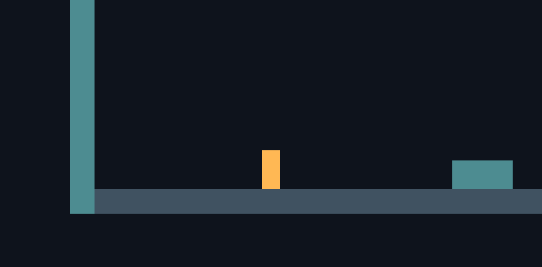
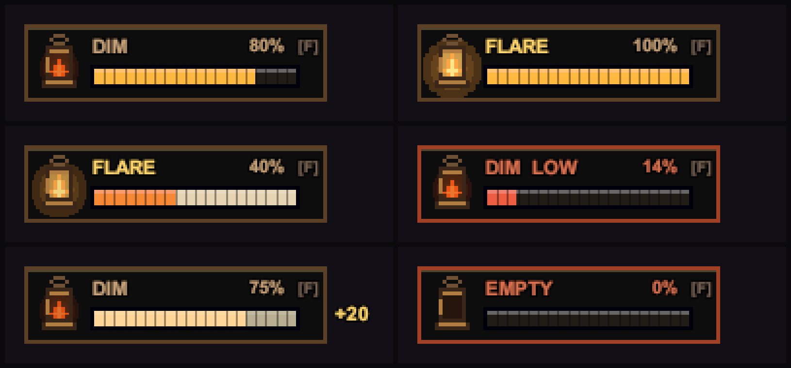

# Siraç — Game Developer

Personal workspace for technical notes and isolated prototypes. The current proposal assigns Siraç the player movement / camera foundation and lantern fuel state / Dim-Flare behavior. The exact scope is in [the developer task split](../../docs/DEVELOPMENT_PLAN.md). Work is developed directly on `main` using scene isolation (`Sandbox/Sirac/`) and script ownership (`Scripts/Player/`, `Lantern/`).

Before starting a system, agree its scope with Kemal. Record its inputs, outputs, and shared dependencies in the task. Move reviewed runtime code into the shared Unity project at `Game/Assets/_Project/Scripts/`.

## Checkpoint 1 — movement and camera (2026-10-15)

Implemented for review in Unity **6000.3.2f1**:

- `PlayerMotor2D`: horizontal movement, grounded detection, a single jump, and collision. Airborne jump presses are discarded.
- `FollowCamera2D`: smooth orthographic camera follow.
- A reusable `PlayerPrototype` prefab with placeholder art and a separate `MovementSandbox` scene containing a floor, boundaries, and three steps.

Open `Game/Assets/_Project/Scenes/Sandbox/Sirac/MovementSandbox.unity` and press Play. Focus the Game view. Move with **A/D or Left/Right**; jump with **Space**. The Input System also binds the gamepad left stick and south button, but a physical gamepad has not been tested. No shared input asset was modified.

Initial tuning is movement speed **5 units/second**, jump velocity **9 units/second**, gravity scale **3**, and ground-check distance **0.06 units**. These are test values, not final balance. The grounded check ignores triggers and rejects side-wall / ceiling normals. The prefab has continuous 2D collision detection, frozen rotation, and a zero-friction / zero-bounce physics material to prevent wall clinging.

### Verification

All **4 Play Mode tests passed** through Unity MCP on 2026-10-15. They instantiate the actual `PlayerPrototype` prefab and exercise the Input System, Rigidbody2D, and colliders: movement in both directions and stopping; one jump with no airborne re-jump plus landing; camera follow; and falling along a side wall while holding toward it. The wall test first reproduced unwanted clinging, which was fixed with the prefab's physics material. The scripts compile without errors.

Tests use a synthetic keyboard and temporarily make test input independent of Editor focus, then restore the previous Input System settings. Normal play still requires focusing the Game view.

Before accepting the movement feel, play the sandbox and check stopping, jump height, platform edges, and camera comfort. Slopes, moving platforms, controller hardware, and final art animation have not been verified. This is a greybox prototype; there is no stage progression or failure flow yet.

## Checkpoint 2 — lantern fuel and Dim / Flare (2026-10-15)

Added to the same sandbox and reusable player prefab:

- `LanternFuel` owns current / maximum fuel, exposes `TrySpendFuel(float)` and `AddFuel(float)` for Kemal's future Power / Drain calls, and raises fuel-changed / depleted events. Spending fails when fuel is insufficient; recovery is capped at capacity and reports the amount accepted.
- `LanternController` toggles Dim / Flare with **F**, applies a warm URP 2D point light, drains fuel in Flare, and returns to Dim at zero. A Game view meter shows the mode and fuel; the light pulses below 25% fuel.
- `EmberPickup` is a reusable trigger prefab that restores a configurable amount. It is consumed only when it restores fuel, so a full lantern leaves it available.
- The sandbox greybox now uses lit sprites and a very low global light, so the lantern changes what is visible.

The sandbox uses **100 fuel capacity**, **80 starting fuel**, a **20-unit pickup**, **0 fuel/second in Dim**, **0.5 fuel/second in Flare**, **2 / 5.5 unit light radii**, and **F** as temporary values. These are inspector-configurable and remain open for review with Kemal and Furkan. There is no death / respawn flow or heartbeat audio yet. The depletion event is the handoff point for a later failure system.

Unity MCP was used to attach the components to the player prefab, create and place the pickup prefab, update and save `MovementSandbox`, and inspect live behavior. From the Game view, moving into the pickup restored fuel from 80 to 100 and removed the pickup; at full fuel the pickup remained. The F key also switched modes while the meter updated. The scene validator found no missing scripts or broken prefabs.

Open the scene in `Game/` using Unity 6000.3.2f1 and press Play. Focus Game view; move with **A/D or Left/Right**, jump with **Space**, and press **F** to switch the lantern. The visible meter and glow provide the current review surface.

## Checkpoint 3 — assembly definition, API refinement, and automated tests (2026-10-15)

Strengthened the lantern foundation for team integration and automated testing:

- **Assembly Definition (`TheLightenRoad.Lantern`):** Separated lantern code into its own assembly referencing `Unity.InputSystem`, `Unity.RenderPipelines.Universal.Runtime`, and `Unity.RenderPipelines.Universal.2D.Runtime`. This allows Kemal's future `TheLightenRoad.Interaction` and `TheLightenRoad.Mechanisms` assemblies to reference the lantern API directly without relying on `Assembly-CSharp`.
- **API additions for Kemal's Power / Drain system:**
  - `LanternFuel.CanSpendFuel(float amount)`: non-mutating check so interaction prompts can preview whether an Ember Vein Power interaction is affordable.
  - `LanternFuel.IsFull` and `LanternFuel.IsEmpty`: clean status queries.
  - `LanternFuel.Initialize(float current, float capacity)`: runtime reconfiguration for test fixtures and stage transitions (cumulative fuel carryover between chambers).
  - `LanternFuel.SetDrainRates(float dimDrain, float flareDrain)`: configurable drain rates.
  - Accessors for starting fuel, drain rates, low-fuel status (`LanternController.IsLowFuel`), low-fuel threshold, toggle key, and pickup amount/collection status (`EmberPickup.FuelAmount`, `EmberPickup.IsCollected`, `EmberPickup.SetFuelAmount`).
- **Comprehensive automated test coverage (22 Play Mode tests, all passed):**
  - `LanternFuelTests` (11 tests): default initialization; custom initialization with non-positive capacity rejection; `TrySpendFuel` deduction, failure, and negative amount rejection; `CanSpendFuel` queries; `AddFuel` capping at capacity, zero return when full, and negative amount rejection; `FuelChanged` and `FuelDepleted` event dispatches; and `TickLanternDrain` consumption across Dim and Flare.
  - `LanternControllerTests` (4 tests): Dim / Flare mode toggle and zero-fuel rejection; auto-revert from Flare to Dim when fuel depletes; low-fuel threshold detection; and synthetic keyboard **F** key input toggle.
  - `EmberPickupTests` (3 tests): exercises the actual `PlayerPrototype` and `EmberPickup` prefabs; confirms 80 to 100 fuel restoration and pickup destruction upon contact; confirms pickup is preserved when lantern is full; and confirms non-player colliders are ignored.
  - `PlayerMotor2DTests` (4 existing tests re-verified): horizontal movement, single grounded jump and airborne rejection, side-wall non-clinging, and camera follow.

### Live Verification

Verified in Unity 6000.3.2f1 via Unity MCP:
- All **22 Play Mode tests passed** (`TestResults.xml` recorded duration ~5.4s).
- Scene validation for `MovementSandbox.unity`: **0 missing scripts, 0 broken prefabs, 0 issues**.
- Unity console: **0 compile errors, 0 warnings**.

## Checkpoint 4 — pixel-art lantern HUD (2026-10-16)

Replaced the legacy debug IMGUI overlay with a fully procedural pixel-art HUD rendered via a pixel-perfect Screen Space Overlay Canvas (reference resolution $640 \times 360$):

- **Component & Assembly (`LanternHUD.cs`, `TheLightenRoad.UI`):**
  - Modular UI assembly cleanly referencing `TheLightenRoad.Lantern`, `UnityEngine.UI`, and `Unity.InputSystem`.
  - Automatically binds to the active player's `LanternController` and listens to `FuelChanged`, `FuelDepleted`, and `FlareChanged` events.
- **Visual Features:**
  - **Procedural Pixel-Art Lantern (`PixelSprites.cs`):** 11×15 brass lantern casing with an animated multi-harmonic flame, glass reflections, and a radial warm glow halo that intensifies during Flare mode.
  - **Segmented Fuel Bar & Drain Trail:** 20 distinct segments with pixel-snapped horizontal filling. Includes a two-phase drain trail (white-amber lag) so energy consumption is readable at a glance.
  - **Dynamic Palette Shift & Low Fuel Warning:** Healthy amber at high capacity, shifting toward hot orange and warning red as fuel diminishes. Below 25% capacity, the border and flame pulse with a heartbeat rhythm, and labels switch to `DIM LOW` / `FLARE LOW`.
  - **Mode Indicator & Input Key Hint:** Crisp labels displaying current mode (`DIM`, `FLARE`, `EMPTY`) along with the configurable toggle key binding (`[F]`).
  - **Pickup & Depletion Feedback:** Floating `+20` popup indicator upon collecting Ember Pickups and a pixel-snapped screen shake when fuel reaches zero.
- **Legacy IMGUI Overlay:** Gated behind `LanternController.ShowDebugOverlay` (disabled by default) to keep production builds clean while preserving debugging capabilities.

### Automated Test Coverage (28 Play Mode tests, all passed)

- Added 6 new automated tests in `LanternHUDTests.cs`:
  - `BuildsOverlayCanvasAndShowsCurrentFuel`: verifies canvas hierarchy construction, controller binding, percentage, and initial fill.
  - `DisplayedFillEasesDownWhileTrailLingers`: confirms the two-stage visual drain trail.
  - `FlareModeUpdatesLabel`: verifies real-time UI reaction to mode toggles.
  - `LowAndEmptyFuelAreFlagged`: confirms low-fuel threshold detection and empty status.
  - `FuelGainShowsPickupFeedback`: verifies the animated pickup feedback.
  - `LegacyDebugOverlayIsOffByDefault`: verifies IMGUI overlay is disabled by default.
- All **28 Play Mode tests passing** in Unity Test Runner.

## Checkpoint 5 — platformer game feel and juice (2026-10-16)

Elevated movement responsiveness in `PlayerMotor2D.cs` with classic high-feel platformer mechanics:

- **Coyote Time (`0.15s`):**
  - Allows jumping within a $0.15$-second window after walking off a platform ledge into midair. Eliminates the frustrating "missed jump" feeling at platform edges.
  - Automatically resets upon jump execution so airborne double jumps remain impossible.
- **Jump Buffering (`0.12s`):**
  - Remembers jump presses initiated within $0.12$ seconds before touching the ground, automatically triggering an immediate jump the exact frame the player lands.
- **Variable Jump Height (Jump Cut `0.5x`):**
  - Releasing Space early while ascending cuts upward velocity in half, allowing players to perform snappy short hops over obstacles or full-height jumps by holding the button.
- **Automatic Sprite Flipping:**
  - Automatically updates `FacingDirection` and sets `SpriteRenderer.flipX` based on horizontal movement input with deadzone filtering.
- **Procedural Squash & Stretch:**
  - Adds visual-only spring deformation on `visualTransform` without distorting the physical `CapsuleCollider2D`:
    - **Takeoff Stretch:** Stretches vertically (`0.85x, 1.25y`) to convey upward energy.
    - **Landing Squash:** Compresses vertically on ground contact (`1.25x, 0.75y`) to convey weight and momentum.
    - Smoothly recovers toward base scale via configurable recovery speed (`squashRecoverySpeed = 9`).

### Automated Test Coverage (32 Play Mode tests, all passed)

- Added 4 new Play Mode tests in `PlayerMotor2DTests.cs`:
  - `MovementInputFlipsSpriteDirection`: verifies `FacingDirection` and `SpriteRenderer.flipX` reaction to left/right input.
  - `CoyoteTimeAllowsJumpShortlyAfterLeavingLedge`: verifies walking past a ledge boundary and executing a jump in midair.
  - `JumpBufferExecutesUponLanding`: verifies pre-landing jump buffering and immediate takeoff on contact.
  - `VisualSquashAndStretchReactsToJump`: verifies vertical stretch on jump initiation and smooth recovery.
- Total **32 Play Mode tests** covering player motor, camera, lantern fuel, dim/flare controller, ember pickups, and HUD.

## Checkpoint 6 — 2D dynamic shadows and organic flame flicker (2026-10-16)

Integrated real-time 2D shadow casting and atmospheric flame undulation into `MovementSandbox.unity` and `LanternController.cs`:

- **2D Dynamic Shadow Casters:**
  - Attached `ShadowCaster2D` to all obstacles and boundaries in `MovementSandbox.unity` (`Step 01`, `Step 02`, `Step 03`, `Left Boundary`, `Right Boundary`).
  - Obstacles now cast crisp, dramatic 2D occlusion shadows across the floor and walls as the player moves with the lantern.
  - Added `ShadowSetupUtility.cs` under `Editor/` providing a 1-click Unity menu item (`Tools -> The Lighten Road -> Setup 2D Dynamic Shadows`) to automatically inspect, attach, and configure `ShadowCaster2D` on any active scene.
- **Organic Flame Flicker:**
  - Added continuous Perlin-noise-driven flame modulation to `LanternController.cs`:
    - Simulates subtle, organic breathing of the flame (`flickerIntensity = 0.04`, `flickerRadius = 0.05`, `flickerSpeed = 8`).
    - Dynamic shadows subtly shift and dance in real-time, elevating the subterranean ruin atmosphere from static lighting to an immersive living torchlight feel.
- **Inspector Tuning Parameters (`LanternController.cs` & `PlayerPrototype.prefab`):**
  - Configurable `enableShadows` toggle, `shadowIntensity` ($0.85$), and `shadowSoftness` ($0.25$).
  - Configurable `enableFlicker` toggle, intensity, and speed.

### Automated Test Coverage (33 Play Mode tests)

- Added automated test in `LanternControllerTests.cs` verifying dynamic shadow and organic flicker property configuration.
- Total **33 Play Mode tests** covering player motor, game feel, camera, lantern fuel, dim/flare controller, shadows/flicker, ember pickups, and HUD.

## Checkpoint 7 — Atmospheric Particle FX: Ambient Dust Motes, Lantern Sparks, and Footstep Dust (2026-10-16)

Elevated subterranean ruin immersion with three reactive 2D particle systems using URP 2D Lit and Unlit shaders:

- **1. Ambient Dust Motes (`DustMotesAtmosphere.cs`):**
  - Ethereal motes lazily drifting across the sandbox environment (`areaSize = (26, 14)`).
  - Uses `Universal Render Pipeline/2D/Sprite-Lit-Default` with soft circular gradient particles.
  - In darkness, motes are almost imperceptible; when illuminated by the player's lantern `Light2D`, they ignite into sparkling warm amber motes, providing breathtaking depth and illumination feedback.
  - Perlin noise turbulence module provides gentle, organic subterranean air currents.
- **2. Lantern Sparks & Embers (`LanternSparksFX.cs`):**
  - Hot fire sparks and embers rising from the lantern flame into the air.
  - Simulated in **World Space**: when the player walks or runs, embers trail behind organically instead of staying locked to the player transform.
  - **Dim Mode:** Calm, slow embers ($4\text{ sparks/s}$, gentle upward float).
  - **Flare Mode (Shift):** Energetic fiery blast ($22\text{ sparks/s}$, faster speed, wider cone, bright yellow-white to deep crimson-ember color over lifetime).
  - **Zero Fuel:** Flame dies and spark emission immediately ceases when fuel reaches 0.
- **3. Footstep & Movement Dust (`PlayerFootstepDustFX.cs`):**
  - Ground movement and kinetic impacts emit subtle dust puffs at the player's feet:
    - **Run Dust:** Emits tiny dust puffs kicking backwards away from `FacingDirection` while moving on stone ground.
    - **Jump Puff:** Bursts outwards horizontally upon takeoff.
    - **Landing Shockwave:** Expanding dust cloud upon touchdown with particle count and velocity scaling dynamically with landing impact velocity.
- **Editor Tooling & Asset Pipelines:**
  - Procedural soft textures (`Particle_SoftCircle.png`, `Particle_Spark.png`, `Particle_DustPuff.png`) and fallback procedural generator (`ParticleTextures.cs`).
  - Added 1-click Editor utility: `Tools -> The Lighten Road -> Setup Atmospheric Particle Effects` in `EffectsSetupUtility.cs`.

### Automated Test Coverage (36 Play Mode tests)

- Added `ParticleEffectsTests.cs` verifying:
  - `DustMotesAtmosphereInitializesAndConfiguresModules`: verifies ParticleSystem creation, box shape, world simulation space, and emission.
  - `LanternSparksFXRespondsToDimAndFlare`: verifies emission rate boost during Flare mode and shutdown on fuel depletion.
  - `PlayerFootstepDustFXInitializesChildSystems`: verifies dynamic instantiation of run dust and burst particle child systems.
- Total **36 Play Mode tests** across player motor, game feel, camera, lantern fuel, dim/flare controller, shadows/flicker, atmospheric particle FX, ember pickups, and HUD.

## Checkpoint 8 — Cinematic Platformer Camera: Look-Ahead, Fall Anticipation, and Landing Shake (2026-10-16)

Elevated camera feel in `FollowCamera2D.cs` with dynamic, responsive platformer tracking tailored to dark subterranean exploration:

- **Horizontal Look-Ahead (`lookAheadDistance = 0.85`, `idleLookAheadDistance = 0.35`):**
  - While running left/right, the camera smoothly leads ahead of the player by $0.85$ units over $0.25$ seconds, eliminating the feeling of moving blindly into the darkness.
  - While stationary, the camera gently settles $0.35$ units ahead in the player's facing direction, giving players a broader view of what lies ahead in their lantern's beam.
- **Vertical Fall Anticipation (`fallLeadDistance = 1.2`, `fallVelocityThreshold = -3.5`):**
  - When descending rapidly off ledges or falling past the $-3.5\text{ m/s}$ threshold, the camera leads downward by up to $1.2$ units.
  - Players can inspect the floor, platforms, or potential hazards below before touching down.
  - Upon landing or grounded recovery, the vertical offset smoothly dampens back to the neutral height ($+1.5$).
- **Impact Screen Shake & Juice (`landingShakeIntensity = 0.08`, `minShakeImpactSpeed = 8`):**
  - Listens to `PlayerMotor2D.OnLanded`: heavy touchdowns from high falls trigger a subtle, punchy procedural camera shake ($0.12\text{s}$).
  - Exposes `Shake(float intensity, float duration)` for manual screen shake invocation (usable by hazards, explosions, or fuel depletion).
  - Shaking is separated from the smooth damping path (`currentFollowPosition + shakeOffset`), ensuring zero jitter in the core follow tracking.
- **Backwards Compatibility & Safety:**
  - Preserves all previous serialized fields (`target`, `offset`, `smoothTime`), ensuring Kemal's `SceneKemal.unity` continues functioning seamlessly without modifications.
  - Works on any target: automatically hooks into `PlayerMotor2D` and `Rigidbody2D` when present, falling back to delta tracking otherwise.

### Automated Test Coverage (40 Play Mode tests)

- Added 4 new Play Mode tests in `FollowCamera2DTests.cs`:
  - `FollowCameraSnapsAndTracksTargetWithOffset`: confirms snapping, base tracking, and offset alignment.
  - `CameraLeadsAheadWhenTargetMovesHorizontally`: verifies positive X leading when moving right and negative X leading when moving left.
  - `CameraAnticipatesFallWhenDescendingRapidly`: verifies downward camera shift when descending with high downward velocity.
  - `CameraShakeActivatesAndDecays`: verifies shake activation, duration timer, and smooth decay to neutral.
- Total **40 Play Mode tests** covering player motor, game feel, camera follow & cinematic juice, lantern fuel, dim/flare controller, shadows/flicker, atmospheric particle FX, ember pickups, and HUD.

### Next checkpoint

## Checkpoint 9 — Death & Respawn Loop with Atmospheric UI/UX (2026-10-16)

Implemented the failure state and retry flow specified in GDD Section 5.3 & 6.2 ("At zero fuel: Trigger the designed failure and respawn flow"):

- **`PlayerRespawnController.cs` (`TheLightenRoad.Player`):**
  - Manages player mortality state machine (`Alive`, `Dying`, `Dead`, `Respawning`).
  - **Darkness Depletion:** Automatically listens to `LanternFuel.FuelDepleted` when fuel drops to 0. Extinguishes the lantern and freezes motor input and physics simulation.
  - **Void / Fall Detection:** Checks vertical position against configurable `voidKillY` threshold (`-5.5`).
  - **Respawn Flow:** Teleports player to active checkpoint/spawn position (`-5, 1, 0`), re-initializes lantern fuel to baseline (`80` fuel), re-ignites lantern, resets camera, and smoothly restores player mobility.
  - **Input Flexibility:** Features an automatic countdown timer (`autoRespawnDelay = 2.4s`) with manual skip support ([Space], [Enter], [R], or Gamepad South) to instantly respawn.
- **`DeathScreenOverlay.cs` & `PixelSprites.cs` (`TheLightenRoad.UI`):**
  - Procedural high-order Screen Space Overlay Canvas (`sortingOrder = 200`, reference resolution $640 \times 360$).
  - **Encroaching Vignette:** Stepped pixel-art radial darkness texture closing in as the character is consumed by the dark.
  - **Void Blackout:** Deep void curtain (`#06070a`) fading over gameplay.
  - **Contextual Lore Messages & Icons:**
    - Darkness: Extinguished flame wisp icon, `"KARANLIKTA KAYBOLDUN"`, *"Fenerin alevi söndü... Karanlık seni yuttu."*
    - Void: Pixel skull icon, `"DİPSİZ KUYUYA DÜŞTÜN"`, *"Eski dünyanın derinliklerinde kayboldun."*
    - Hazard: `"YOK OLDUN"`, *"Harabelerin ölümcül tehlikesi seni yakaladı."*
  - **Animated Prompt & Countdown Bar:** Breathes with a warm amber pulse (`[SPACE] / [R] Yeniden Doğ`) and displays a smooth horizontal countdown progress bar.
  - **Rekindling Flash:** On respawn, a warm golden-orange radial bloom flashes from the center as the lantern's flame bursts back to life.
- **`HazardTrigger2D.cs` (`TheLightenRoad.Player`):**
  - Modular trigger component for environmental dangers and void zones. Added a $50$-unit wide `Void Pit` trigger at $Y = -6$ in `MovementSandbox.unity`.

### Automated Test Coverage (44 Play Mode tests)

- Added 4 new Play Mode tests in `PlayerRespawnTests.cs`:
  - `DepletedFuelTriggersDarknessDeath`: verifies death state, motor shutdown, and overlay activation upon fuel depletion.
  - `FallingBelowVoidLimitTriggersVoidDeath`: verifies void limit detection.
  - `HazardTriggerKillsPlayerOnContact`: verifies `HazardTrigger2D` collision trigger.
  - `RespawnRestoresPlayerFuelPositionAndMotor`: verifies complete restoration of player position, 80 fuel, and movement capabilities.
- Total **44 Play Mode tests** across player motor, game feel, camera follow & cinematic juice, lantern fuel, dim/flare controller, shadows/flicker, atmospheric particle FX, death/respawn loop, ember pickups, and HUD.

### Next checkpoint

## Checkpoint 10 — Game Designer Furkan Feedback #1: Discrete Ember Economy, RPG HUD, Office Room Scale, and 100% Darkness (2026-10-16)

Resolved all design points from GitHub Issue #1 (`F_Feedback#1`) opened by Game Designer Furkan Aydın (`@aeshmacodex`):

- **1. Level Design — Human Office Scale & Dynamic Ceiling Shadows:**
  - Real human office proportions: ceiling is positioned ~1 body height above the player ($1.6\text{m}$ character $\rightarrow$ ceiling bottom at $Y = 3.2\text{m}$, top at $Y = 3.45\text{m}$).
  - Added an office doorway partition leaving a $1.7\text{m}$ clearance door.
  - Equipped with `ShadowCaster2D` and URP 2D Lit materials, allowing the lantern's light to hit the ceiling directly and cast dramatic upward and doorway shadows.
- **2. 100% Pitch Black Stage Darkness:**
  - `Global Light 2D` in `MovementSandbox.unity` set to pure black `{r: 0, g: 0, b: 0, a: 1}` and `intensity = 0` (0% ambient light, true pitch darkness instead of 80% opacity).
- **3. Infinite Baseline Dim Light:**
  - The character **always** has an infinite baseline light resource in hand; `dimDrainPerSecond = 0f`.
  - The lantern will never run out of light naturally in Dim mode.
- **4. Tuned Light Radii (50% & 200% of previous Flare):**
  - **Dim Radius:** $2.75\text{ units}$ ($50\%$ of previous $5.5$).
  - **Flare Radius:** $11.0\text{ units}$ ($200\%$ of previous $5.5$).
  - **Intensities:** Dim $= 0.55$, Flare $= 1.25$.
- **5. Discrete Ember Economy & RPG Health-Bar HUD (`LanternHUD.cs` & `PixelSprites.cs`):**
  - Replaced continuous fuel gauge with an RPG HP-bar style layout in the top-left corner.
  - **5 Discrete Slots:** Displays up to 5 ember crystal sockets horizontally:
    - **Full Ember:** 2 charges (bright amber crystal with white-hot core).
    - **Half Ember:** 1 charge (cracked ember stone with half charge remaining).
    - **Empty Socket:** 0 charges (dark bronze socket frame).
  - **Timed Scout Pulse:** Pressing `[F]` spends 1 charge (`TrySpendCharge()`) and flares the lantern for a $6.0\text{s}$ timed scout pulse, then automatically dampens back to infinite Dim.
  - **Dynamic `+N` Overflow Badge:** Inventory capacity expands dynamically. When total embers exceed 5, a golden `+1`, `+2`, `+N` badge appears to the right of the 5th icon (e.g., 9 embers $= 5$ icons $+ 4$ badge).
  - **Always-Collected Pickups:** Pickups (`EmberPickup.cs`) are **always** collected into inventory regardless of current count (never rejected).
  - **HUD Feedback:** Shows live scout timer countdown (`ALEV İZCİSİ (4.2s)`), empty state warning (`[F] KOR TÜKENDİ`), and floating pickup feedback (`+1 KOR`).
- **6. Character Animations:**
  - Preserved existing sprite setup without touching animation clips or controllers, respecting Furkan's note that animations are assigned to artists Can & Maksim.

### Automated Test Coverage (45 Play Mode tests)

- Updated and expanded test suites across all affected modules:
  - `LanternHUDTests.cs`: 6 tests verifying 5-slot hierarchy, Full/Half/Empty visual states, `+N` overflow badge, Flare scout label/timer, empty state, and pickup feedback popup.
  - `EmberPickupTests.cs`: 3 tests verifying charge increments, always-collected overflow behavior, and non-player trigger filtering.
  - `LanternFuelTests.cs`: 12 tests verifying discrete ember properties (`TotalCharges`, `TotalEmbers`, `FullEmbers`, `HasHalfEmber`, `OverflowEmbers`), charge deductions, and infinite Dim drain.
  - `LanternControllerTests.cs`: 6 tests verifying $2.75$ / $11.0$ radii, timed scout expenditure, low-fuel threshold, and shadow settings.
- **100% Pass Rate: 45 / 45 Play Mode tests passing.**

### Next checkpoint

Continue expanding player systems in `Sandbox/Sirac/`:
1. Procedural 8-bit audio feedback / sound synthesis for footsteps, jumps, flame ignition, and low-fuel heartbeat.
2. Secret wall runes / glyphs that only reveal when illuminated by Flare mode.

