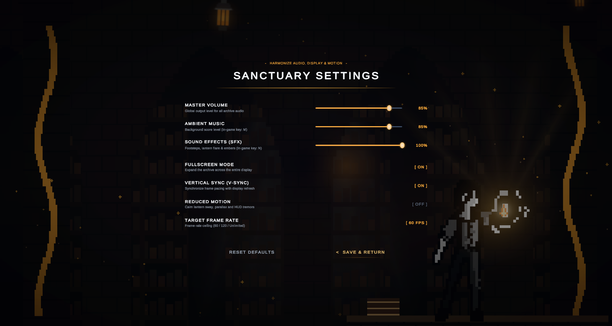
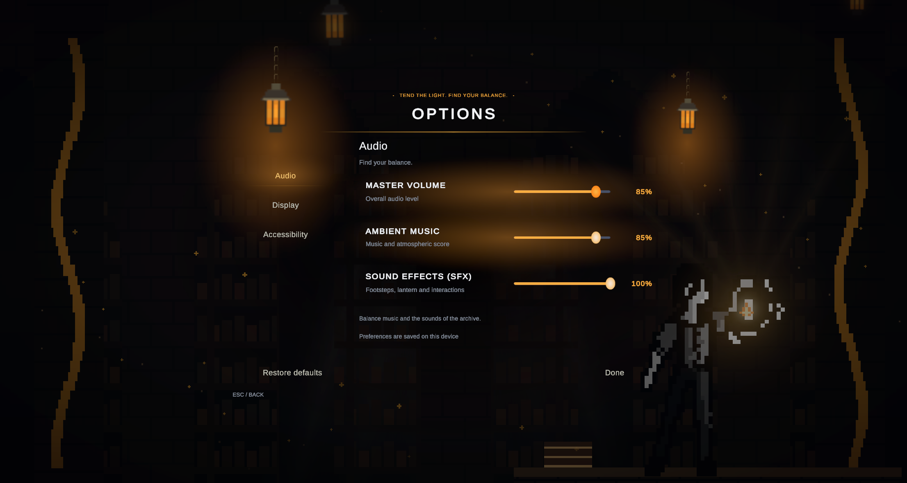
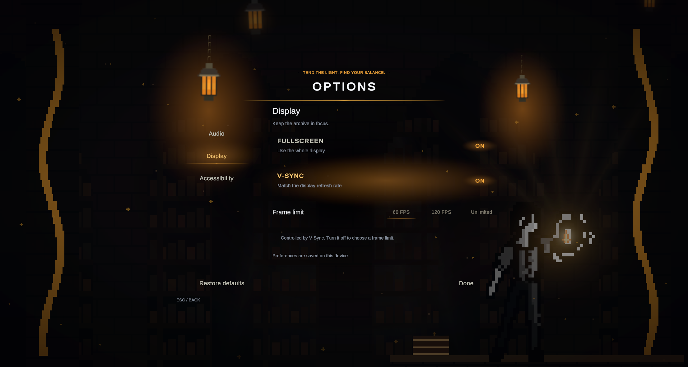
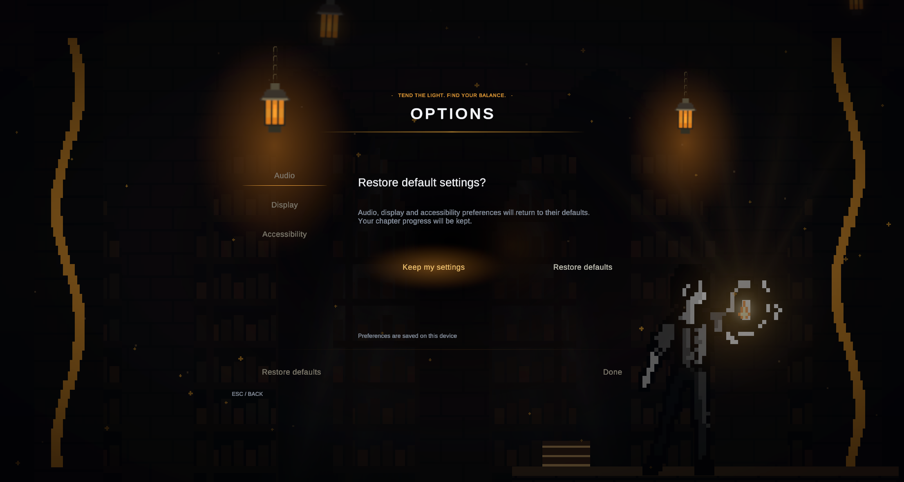
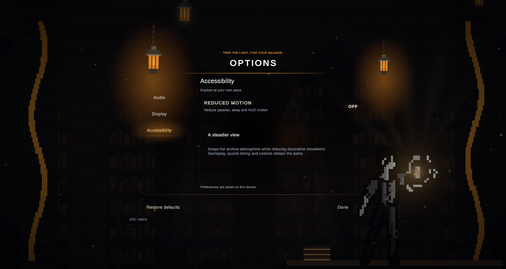

# Archive settings UX — 23 October 2026

Scope: the main menu's Options view and settings persistence. The existing title, archive stage, chapter selection and Credits view are preserved. There is no save-slot screen in this checkout; this change does not invent one.

## Review and implemented changes

1. **Original settings — crowded and hard to scan.** Audio, display and motion shared one list. Small descriptions competed with the archive background; inactive switches were low-contrast. Options were applied immediately, but the footer's “Save & Return” did not communicate when they reached disk.

   

2. **Audio — clearer, themed and working.** Three categories preserve a stable control column with larger labels, percentage readouts and 44px slider hit areas. The approved direction is frameless: actual project cage-lamp/chain art, warm animated illumination, brass rules and light-based focus. The intermediate square-panel design was replaced. Preferences save after a short debounce, with visible confirmation, and flush when returning to the title.

   

3. **Display — explicit control relationships.** Fullscreen and V-Sync use readable ON/OFF states. Frame limits are direct 60/120/Unlimited choices rather than a cycling button. V-Sync disables the frame-limit controls and explains why; the stored choice remains visible.

   

4. **Restore defaults — safe cancellation and progress protection.** A dedicated confirmation explains the effect and initially focuses “Keep my settings”. Escape cancels the confirmation first. Previously `MenuPreferences.ResetToDefaults()` also deleted realm-completion flags; it now restores preferences only, including when called by the existing pause menu.

   

5. **Accessibility — clear state and calmer motion.** Reduced Motion remains readable when OFF and removes the new lantern sway/light oscillation. It also removes focus-light breathing. Category navigation has explicit directional links and visible focus; inactive category contents are deactivated.

   

## Reuse and validation

`MainMenuSettingsView.cs` contains the settings layout separately from the main controller. `SettingsLightFocus` and `SettingsLanternAmbience` own their small visual behaviors. Existing lamp, chain, radial and filigree assets are reused; no generated replacement artwork or new package was introduced.

Unity 6000.3.2f1 PlayMode: **14/14 passed**, zero skipped, 2.858s. Suites: `MainMenuTests` and `PauseMenuTests`. Coverage includes category activation, reset cancellation/confirmation, progress retention, V-Sync/frame-limit rules, audio preferences/save feedback, menu subview isolation during game start and existing pause flows. [Recorded results](previews/settings-ux/playmode-results.xml).

The five screenshots above were captured from the running Unity scene in this session, saved and inspected. The final four show stable states after transitions. An earlier capture that disturbed the view was rejected and replaced. The temporary Editor inspection/test helper was removed after validation.

Limits: no standalone build, physical gamepad, screen-reader or full accessibility-compliance claim. The native pointer automation could not target the Unity window reliably; view setup used a temporary Editor harness and controls were verified through the PlayMode suites. Visual review covers the current Game view, not a full device/aspect-ratio matrix. Kemal-owned mechanisms and scenes were not edited.
