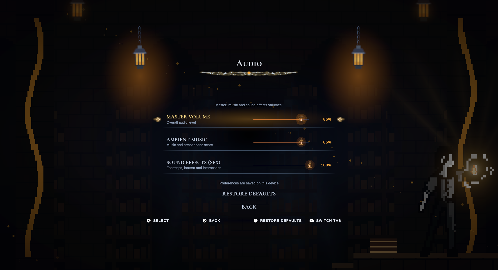
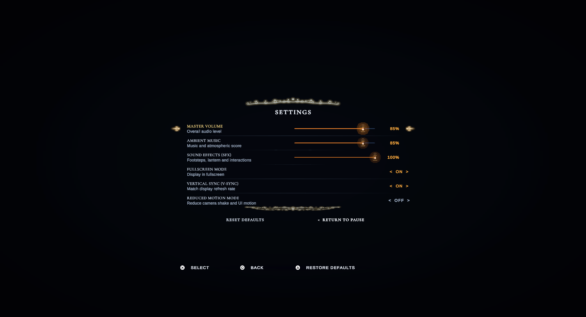

# Miniature lantern slider handles

2026-10-26 — Unity 6000.3.2f1.

Audio and stick-deadzone slider handles now use a 22 × 30 miniature lantern, reusing the existing `PixelSprites.LanternFrame`, `Flame` and `Glow` artwork. The title menu and pause settings share `LanternSliderHandle`.

- Small flame flicker, subtle sway and warm light replace the old round handle and triangle marker.
- Keyboard/gamepad focus, hover and pointer press brighten the lantern. Disabled controls dim it.
- The interaction target remains a stable **44 × 44** transparent rectangle. Only child artwork animates; the slider's driven handle anchors and value are not animated.
- Artwork does not intercept raycasts. Existing drag, keyboard/controller navigation, percentage labels and saved preferences remain in the Slider implementation.
- Reduced motion freezes sway, bob and flame flicker while retaining static focus/pressed feedback. Unscaled timing keeps pause-menu animation working.
- Shared pixel sprites are reused; no downloaded/generated bitmap, scene modification or new package is needed.

## Verification

**27/27** main-menu, pause and controller-support PlayMode tests passed after the change. Live Game-view review includes the audio page and paused settings; animation frame traces confirmed that values stayed at 0.85 / 0.85 / 1.0 across changing flame/pose samples, while Reduced motion reset position, rotation and flame scale to their stationary values.

